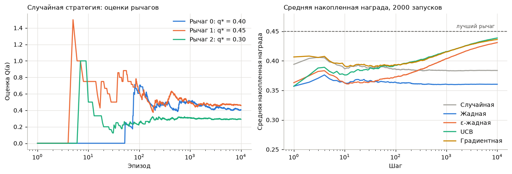
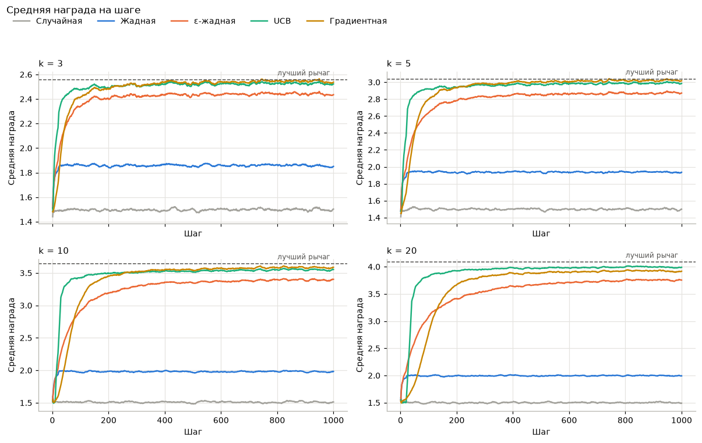
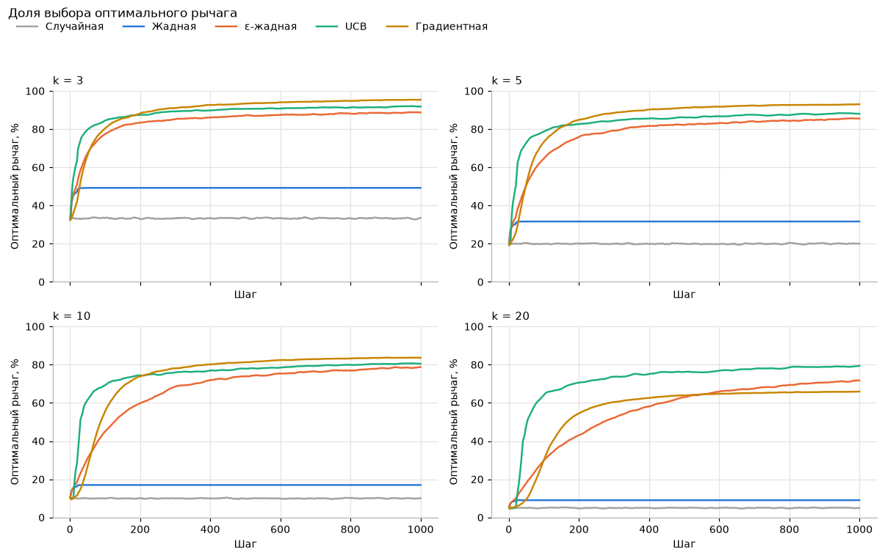
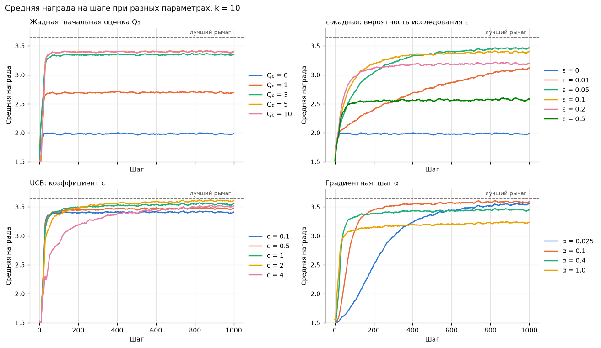
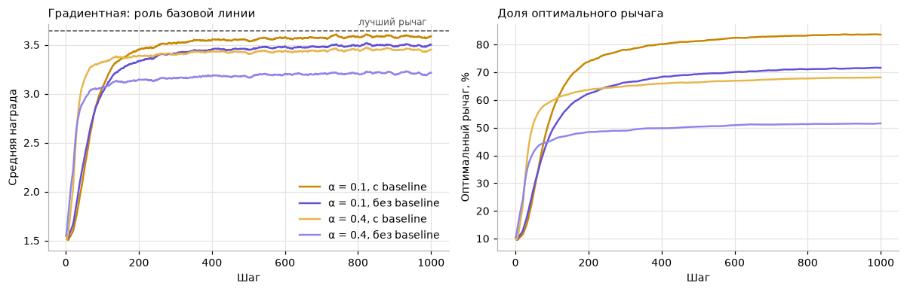
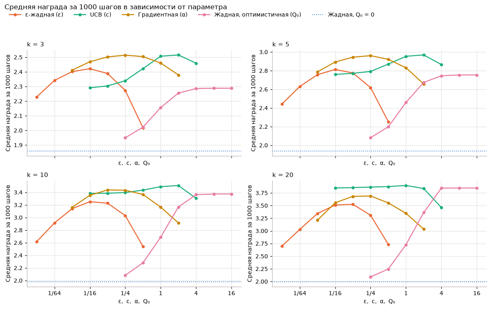
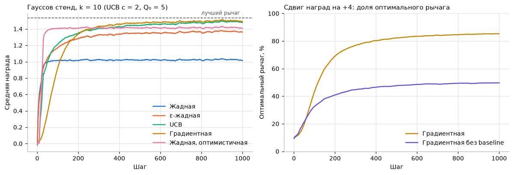

# Лаба 1 «Многорукий бандит» — разбор для себя

Тут простыми словами разобрано всё: что за задача, зачем она нужна, что делает каждая строчка кода,
что нарисовано на каждом графике и что могут спросить на сдаче. Сам отчёт для сдачи — `lab1_bandits.ipynb`
(и его PDF-версия), а этот файл — шпаргалка, чтобы во всём разобраться.

Порядок такой:
1. Смысл задачи на пальцах
2. Словарик (что значит каждое слово)
3. Как устроен эксперимент
4. Стратегии: идея, формула, плюсы и минусы
5. Код по строчкам
6. Каждый график: что на нём и как читать
7. Итоги в двух словах
8. Каверзные вопросы и ответы
9. Как всё запустить

<!-- pagebreak -->

## 1. Смысл задачи на пальцах

### Казино

Ты пришёл в казино. Перед тобой автомат с несколькими ручками (в англоязычной литературе однорукий бандит — это
обычный игровой автомат, «многорукий» — автомат с кучей ручек). Каждая ручка платит по-своему: одна часто,
но по чуть-чуть, другая редко, но много. **Как ручки платят, тебе не сказали.** У тебя 1000 попыток.
Как набрать как можно больше денег?

Проблема в том, что узнать, какая ручка хорошая, можно только подёргав её. Но каждая попытка на плохой ручке —
потерянные деньги. Получается вечный выбор:

* **Использовать (exploitation)** — дёргать ту ручку, которая пока что кажется лучшей. Сразу получаешь неплохую награду.
* **Исследовать (exploration)** — дёргать другие ручки, вдруг какая-то из них на самом деле лучше.
  Сейчас, скорее всего, потеряешь, но можешь найти ручку получше на будущее.

Это и есть **дилемма «исследование — использование»** — главная идея всей лабы. Все стратегии в работе —
это разные способы решать, когда исследовать, а когда использовать.

### То же самое из жизни

* **Ресторан.** Ходишь в любимый ресторан (использование) или пробуешь новый (исследование)? Если всегда ходить
  в один и тот же, никогда не узнаешь, что за углом есть лучше. Если всё время пробовать новые, часто будешь есть
  невкусно.
* **Реклама и A/B-тесты.** Сайт показывает пользователям один из 5 вариантов баннера. Какой из них больше кликают,
  заранее неизвестно. Хочется быстро найти лучший и показывать в основном его — это ровно бандит.
* **Рекомендации** (музыка, видео): показать то, что тебе точно нравится, или попробовать что-то новое.
* **Медицина:** какое из нескольких лекарств давать следующим пациентам, пока испытание ещё идёт.

### При чём тут обучение с подкреплением

В обучении с подкреплением (RL) есть **агент** (тот, кто принимает решения) и **среда** (то, с чем он взаимодействует).
Агент делает **действие**, среда возвращает **награду**. Цель агента — набрать максимум награды. Многорукий бандит —
самая простая RL-задача: у неё нет «состояний» (автомат всегда один и тот же, ничего не меняется от твоих действий),
есть только выбор действия и награда. Поэтому на ней удобно разбираться с главной проблемой RL — исследованием.

### Что требуется в лабе

1. Сделать среду (автомат) и агентов с разными стратегиями: жадная, ε-жадная, UCB, градиентная (softmax).
2. Проверить на разном числе ручек (у нас 3, 5, 10, 20).
3. Посмотреть, как результат зависит от параметров каждой стратегии.
4. Нарисовать графики средней награды и сделать выводы.

<!-- pagebreak -->

## 2. Словарик

| Слово | Что значит простыми словами |
|---|---|
| Ручка, рычаг, действие (action), arm | Один из вариантов выбора. В коде это номер от 0 до k−1. |
| k | Сколько у автомата ручек. |
| Награда (reward) R | Что выдал автомат после того, как дёрнули ручку. У нас либо 0, либо выигрыш от 1 до 5. |
| Шаг (step), эпизод | Одна попытка: выбрал ручку → получил награду. |
| Ценность ручки q\*(a) | Сколько ручка даёт **в среднем**, если её дёргать бесконечно. У нас это шанс × выигрыш. Агент её **не знает**. |
| Оценка ручки Q(a) | То, что агент **думает** про ценность ручки, — средняя награда, которую ручка уже принесла. |
| N(a) | Сколько раз агент уже дёрнул ручку a. |
| Лучшая (оптимальная) ручка | Ручка с наибольшей ценностью q\*. |
| Потолок | Ценность лучшей ручки. Больше этого в среднем не получить никакой стратегией. |
| Агент, стратегия, политика (policy) | Правило, по которому выбирается ручка. |
| Среда (environment) | Сам автомат: принимает номер ручки, возвращает награду. |
| Запуск (run) | Одна полная игра: новый случайный автомат и 1000 шагов. |
| Жадный выбор | Взять ручку с наибольшей оценкой Q. |
| Исследование / использование | Пробовать другие ручки / дёргать лучшую по текущей оценке. |
| Стационарный бандит | Ценности ручек не меняются со временем (у нас так). |
| Regret (сожаление) | Сколько недополучил по сравнению с тем, если бы с самого начала знал лучшую ручку. |
| seed | Число, от которого генерируются случайные числа. Одинаковый seed — одинаковая «случайность», результат повторяется. |

<!-- pagebreak -->

## 3. Как устроен эксперимент

### Автомат

Автомат как в методичке преподавателя: у каждой ручки есть **шанс выигрыша** p (например 0.3 = 30 %) и **размер выигрыша** r
(например 4). Дёрнул ручку — с шансом p получаешь r, иначе 0. В среднем ручка даёт p × r. Например, ручка с p = 0.1 и r = 4
в среднем даёт 0.4 за попытку, а ручка с p = 0.3 и r = 1 — только 0.3, хотя выигрывает в три раза чаще.

### Почему 2000 запусков

Одна игра — это лотерея: агенту может повезти или не повезти. Чтобы понять, насколько хороша **стратегия**, а не
отдельная игра, мы играем 2000 раз (каждый раз с новым случайным автоматом) и усредняем. Кривая на графике —
это «как в среднем играет эта стратегия». В каждом запуске шансы ручек случайные от 0 до 1, а выигрыши — случайные целые
от 1 до 5.

### Почему 1000 шагов

За 1000 шагов все нормальные стратегии успевают выйти на плато, и видно, кто учится быстрее, а кто в итоге играет лучше.

### Почему одинаковый seed

Все стратегии играют на **одних и тех же** 2000 автоматах. Тогда, если одна кривая выше другой, это заслуга стратегии,
а не того, что ей достались автоматы попроще.

### Почему всё «массивами»

В методичке цикл идёт по шагам для одного автомата. Если делать так же для 2000 запусков, получится цикл в цикле,
и всё будет считаться очень долго. Поэтому мы делаем таблицу 2000 × k: каждая строка — свой автомат, и за одну операцию
numpy обрабатывает все 2000 автоматов сразу. Представь зал с 2000 игроками, каждый у своего автомата, и все дёргают
ручки одновременно по команде. Математика от этого не меняется, просто считается быстрее.

### Что меряем

* **Средняя награда на шаге t** — сколько в среднем (по 2000 игрокам) получили на шаге t. Главный график по заданию.
* **Доля выбора лучшей ручки на шаге t** — какой процент игроков на шаге t дёрнул лучшую ручку.
* **Средняя награда за все 1000 шагов** — одно число на стратегию. Учитывает и скорость обучения, и итоговый уровень.

<!-- pagebreak -->

## 4. Стратегии

### 4.0. Как агент оценивает ручку (общее для жадной, ε-жадной и UCB)

Оценка ручки Q(a) — средняя награда, которую ручка уже принесла. Например, дёрнули ручку 4 раза, получили 0, 3, 0, 3 —
оценка (0+3+0+3)/4 = 1.5.

Хранить все награды не нужно — среднее можно обновлять на ходу:

$$Q_{new} = Q_{old} + \dfrac{1}{N}\,(R - Q_{old})$$

Читается так: «новая оценка = старая + (сколько ошиблись) / (сколько раз пробовали)». Если награда больше оценки,
оценка подрастает, если меньше — опускается. И с каждым разом всё слабее, потому что делим на растущее N.
Это **ровно то же самое** среднее арифметическое, просто посчитанное по шагам.

Пример: Q = 1.5 после 4 попыток, пятая награда R = 3. Новая оценка 1.5 + (3 − 1.5)/5 = 1.8. Проверка: (0+3+0+3+3)/5 = 1.8. Сходится.

### 4.1. Случайная

Каждый раз дёргает ручку наугад. Ничему не учится. Нужна как **нижняя планка**: любая нормальная стратегия должна быть лучше.
В среднем даёт среднее по всем ручкам и выбирает лучшую ручку в 1/k случаев.

### 4.2. Жадная (greedy, ε = 0)

Всегда дёргает ручку с наибольшей текущей оценкой Q. Если оценки равны, выбирает случайную из них.

**Проблема:** в начале все оценки 0. Агент дёрнул случайную ручку, она выиграла 2 — её оценка стала 2, остальные 0.
Дальше агент всегда будет дёргать её, ведь 2 > 0. Даже если другая ручка в среднем даёт 4, агент об этом не узнает:
он её ни разу не попробует. **Жадная стратегия не исследует и застревает на первой попавшейся ручке.**

### 4.3. Жадная с оптимистичными начальными оценками (Q₀ > 0)

Тот же жадный агент, но в начале все оценки не 0, а, например, 5 («я думаю, все ручки офигенные»). Дёрнул ручку,
получил 2 — оценка упала ниже 5, теперь эта ручка кажется хуже нетронутых. Агент идёт пробовать следующую.
В итоге он перепробует все ручки, а потом будет дёргать ту, что оказалась лучшей.

* **Плюс:** исследование «бесплатно», без случайности. Хорошо работает, когда ручек много.
* **Минус:** исследует только в начале. Если в начале агенту не повезло и он недооценил лучшую ручку, он к ней не вернётся.
  Q₀ должна быть не меньше максимально возможной ценности ручки, иначе не сработает.

### 4.4. ε-жадная (epsilon-greedy)

С вероятностью ε (например 0.1 = 10 %) дёргает **случайную** ручку, иначе — жадный выбор.

* **Плюс:** исследует всегда, поэтому со временем найдёт лучшую ручку.
* **Минус:** исследует **всегда**, даже когда уже всё понятно. 10 % ходов — наугад, а значит, награда всегда ниже потолка.
  И исследует вслепую: может сто раз проверять заведомо плохую ручку.
* **ε маленькое** (0.01): исследует мало, учится медленно. **ε большое** (0.5): учится быстро, но половина ходов —
  мусор, потолок низкий. Лучшее где-то посередине (у нас 0.05–0.1).

### 4.5. UCB (Upper Confidence Bound, верхняя доверительная граница)

Идея: «сомневаешься — проверь». К оценке ручки добавляется бонус за неуверенность. Чем реже ручку пробовали, тем меньше
мы про неё знаем, тем больше бонус. Выбираем ручку с наибольшей суммой «оценка + бонус».

$$A_t = \arg\max_a \left[ Q_t(a) + c\,\sqrt{\dfrac{\ln t}{N_t(a)}} \right]$$

Расшифровка:
* **Aₜ** — какую ручку выбираем на шаге t;
* **argmax по a** — «та ручка a, у которой выражение в скобках наибольшее»;
* **Qₜ(a)** — текущая оценка ручки;
* **Nₜ(a)** — сколько раз её уже дёргали. Стоит в знаменателе: чем больше пробовали, тем меньше бонус;
* **ln t** — логарифм номера шага. Медленно растёт: ручки, которые давно не трогали, постепенно снова получают
  большой бонус, и агент про них «вспоминает»;
* **c** — насколько сильно ценим неуверенность. Больше c — больше исследуем.

Ручки, которые ещё ни разу не дёргали, получают бесконечный бонус, поэтому в первые k шагов агент пробует каждую ручку по разу.

* **Плюс:** исследует **прицельно** — проверяет только те ручки, про которые реально мало знает, а не все подряд.
  Поэтому у нас UCB лучшая.
* **Минус:** c нужно подбирать под масштаб наград. Сложнее переносится на задачи посложнее (нестационарные, с состояниями).

### 4.6. Градиентная (gradient bandit, softmax)

Совсем другой подход. Агент не оценивает, сколько даёт ручка. Вместо этого у него для каждой ручки есть
**предпочтение H(a)** — просто число: «насколько мне нравится эта ручка». Ручку он выбирает **случайно**, но с вероятностями,
которые зависят от предпочтений. Вероятности считаются через **softmax**:

$$\pi(a) = \dfrac{e^{H(a)}}{\sum_b e^{H(b)}}$$

Softmax превращает любые числа в вероятности: все положительные, в сумме дают 1, у большего числа — большая вероятность.
Пример: H = [0, 1, 2] → e^H ≈ [1, 2.72, 7.39], сумма ≈ 11.1 → π ≈ [0.09, 0.24, 0.67]. Ручка с H = 2 выбирается в 67 % случаев.
В начале все H = 0, значит, все вероятности равны — выбор наугад.

**Как учится.** После каждого шага сравниваем полученную награду со **средней наградой** R̄ (базовая линия, baseline):
* награда **выше средней** → выбранной ручке предпочтение повышаем, остальным понижаем;
* награда **ниже средней** → выбранной ручке понижаем, остальным повышаем.

$$H(A_t) \leftarrow H(A_t) + \alpha\,(R_t - \bar{R}_t)\,(1 - \pi(A_t))$$

$$H(a) \leftarrow H(a) - \alpha\,(R_t - \bar{R}_t)\,\pi(a), \quad a \neq A_t$$

* **α** — шаг обучения: насколько сильно сдвигаем предпочтения за раз;
* **Rₜ − R̄** — насколько награда лучше (или хуже) обычной;
* **(1 − π)** и **π** — поправки, благодаря которым это получается честный шаг градиентного подъёма.

**Почему «стохастический градиентный подъём».** Мы хотим максимизировать ожидаемую награду — сумму π(a)·q\*(a) по всем ручкам.
Градиент показывает, куда менять H, чтобы она росла. Точно посчитать градиент нельзя: q\* мы не знаем. Но формула выше в среднем
равна этому градиенту (доказательство — в учебнике Саттона и Барто, раздел 2.8). То есть мы двигаемся вверх по «зашумлённому»
градиенту, оценённому по одному случайному шагу. Это и есть стохастический градиентный подъём.

**Зачем базовая линия.** У нас все награды ≥ 0. Без базовой линии (R̄ = 0) **любая** награда, даже маленькая, повышает
предпочтение выбранной ручки. Получил 1 от плохой ручки — она всё равно стала «любимее». С базовой линией 1 при средней 3 —
это плохо, и предпочтение понизится. На градиент в среднем базовая линия не влияет, но сильно уменьшает разброс
(шум) обновлений, и учиться получается быстрее и точнее.

* **α маленькое** — учится медленно, но надёжно. **α большое** — быстро «влюбляется» в одну ручку, не успев
  нормально проверить остальные (преждевременная сходимость).

<!-- pagebreak -->

## 5. Код по строчкам

Код в ноутбуке разбит на ячейки. Ниже — каждая ячейка по порядку. Сам код и так прокомментирован,
а тут разобраны все неочевидные места и «магия» numpy.

### Ячейка 1. Импорты и настройки графиков

```python
import numpy as np
import matplotlib.pyplot as plt
import matplotlib.ticker as mticker
from functools import partial
plt.rcParams.update({...})
```

* `numpy` (сокращённо `np`) — библиотека для работы с массивами чисел. Вся математика через неё.
* `matplotlib.pyplot` (`plt`) — рисование графиков.
* `mticker` — нужен один раз, чтобы на оси x писать 1/16 вместо 0.0625.
* `partial` — штука, которая «заранее подставляет» аргументы в функцию. `partial(UCBAgent, c=2)` — это как
  `UCBAgent`, у которого c уже равно 2. Потом можно вызвать `make(n, k, rng)`, и получится `UCBAgent(n, k, rng, c=2)`.
  Используется, чтобы передавать в `run` «рецепт» агента с нужными параметрами.
* `plt.rcParams.update(...)` — общий стиль всех графиков: сетка, толщина линий, размер шрифта. На смысл не влияет.

### Ячейка 2. Среда BanditEnv

```python
class BanditEnv:
    def __init__(self, payout, reward, rng):
        self.payout = np.asarray(payout, dtype=float)
        self.reward = np.asarray(reward, dtype=float)
        self.rng = rng
        self.n_runs, self.n_arms = self.payout.shape
        self.q_true = self.payout * self.reward
        self.best_action = self.q_true.argmax(axis=1)
        self.best_value = self.q_true.max(axis=1)
        self._idx = np.arange(self.n_runs)
```

* `class BanditEnv:` — описываем «чертёж» автомата. По нему потом создаём конкретные автоматы.
* `__init__` — что делается при создании автомата. `self` — «этот конкретный автомат».
* `payout`, `reward` — таблицы размера R × k (R запусков, k ручек). Строка i — автомат i-го запуска,
  столбец a — ручка a. `payout[i, a]` — шанс выигрыша ручки a в автомате i.
* `np.asarray(..., dtype=float)` — превращаем что дали (список или массив) в массив numpy из дробных чисел.
* `rng` — генератор случайных чисел (random number generator). Свой у каждой среды, чтобы результаты повторялись.
* `.shape` — размеры таблицы, например (2000, 10). Раскладываем в две переменные: число запусков и число ручек.
* `q_true = payout * reward` — умножение **поэлементно**: для каждой ручки каждого автомата шанс × выигрыш.
  Это настоящие ценности ручек. Агент их не видит, они нужны, чтобы считать, выбрал ли агент лучшую.
* `argmax(axis=1)` — в каждой **строке** (axis=1 = «вдоль строки», по ручкам) найти номер наибольшего элемента.
  Получаем массив из R чисел: номер лучшей ручки в каждом автомате.
* `max(axis=1)` — то же, но само значение максимума: ценность лучшей ручки.
* `np.arange(n_runs)` — массив [0, 1, 2, …, R−1]. Нужен для трюка с индексацией (см. ниже).

```python
    @classmethod
    def fixed(cls, payout_list, reward_list, n_runs, rng):
        payout = np.tile(payout_list, (n_runs, 1))
        reward = np.tile(reward_list, (n_runs, 1))
        return cls(payout, reward, rng)
```

* `@classmethod` — «альтернативный способ создать автомат». Вызывается как `BanditEnv.fixed(...)`. `cls` — это сам класс BanditEnv.
* `np.tile(список, (n_runs, 1))` — повторить строку n_runs раз вниз. Из [0.1, 0.15, 0.3] получится таблица 2000 × 3,
  где все строки одинаковые. Так все запуски играют на автомате из методички.

```python
    @classmethod
    def random(cls, n_arms, n_runs, rng):
        payout = rng.uniform(0.0, 1.0, size=(n_runs, n_arms))
        reward = rng.integers(1, 6, size=(n_runs, n_arms))
        return cls(payout, reward, rng)
```

* `rng.uniform(0, 1, size=...)` — таблица случайных дробных чисел от 0 до 1 (шансы выигрыша).
* `rng.integers(1, 6, size=...)` — случайные целые от 1 до 5. Правая граница **не включается**, поэтому 6.

```python
    def step(self, action):
        p = self.payout[self._idx, action]
        r = self.reward[self._idx, action]
        return np.where(self.rng.random(self.n_runs) < p, r, 0.0)
```

* `step` — «дёрнуть ручку». `action` — массив из R номеров ручек, по одному на каждый автомат.
* **Главный трюк numpy:** `payout[self._idx, action]`. Если `_idx = [0, 1, 2]`, а `action = [4, 0, 7]`, то получится
  `[payout[0, 4], payout[1, 0], payout[2, 7]]` — из каждой строки берём свой столбец. Это «шанс выбранной ручки в каждом автомате».
* `self.rng.random(self.n_runs)` — R случайных чисел от 0 до 1.
* `... < p` — массив True/False: True там, где случайное число меньше шанса, то есть выиграли.
  Например, шанс 0.3: случайное число попадает ниже 0.3 ровно в 30 % случаев.
* `np.where(условие, a, b)` — поэлементно: где условие True, берём a, иначе b. Значит, где выиграли — r, иначе 0.

**GaussianBanditEnv** — то же самое, но ценности ручек из нормального распределения N(0, 1) (`rng.normal(0, 1, ...)`),
а награда — `rng.normal(q_true[...], 1.0)`, то есть ценность плюс случайный шум. Нужен только для проверки в разделе 8.

### Ячейка 3. Стратегии

#### argmax_random

```python
def argmax_random(values, rng):
    is_max = values == values.max(axis=1, keepdims=True)
    return np.argmax(is_max * rng.random(values.shape), axis=1)
```

* Зачем: обычный `np.argmax` при равенстве всегда возвращает **первый** максимум. В начале все оценки 0, и агент
  всегда выбирал бы ручку 0 — это нечестно. Нужно, чтобы при ничьей ручка выбиралась случайно.
* `values.max(axis=1, keepdims=True)` — максимум в каждой строке. `keepdims=True` оставляет результат в виде столбца
  (R × 1), а не плоского списка, чтобы его можно было сравнить с каждой строкой таблицы.
* `values == ...` — таблица True/False: True там, где значение равно максимуму строки.
* `is_max * rng.random(...)` — True превращается в 1, False в 0. Умножаем на случайные числа: у не-максимумов 0,
  у максимумов — случайное число от 0 до 1. Самое большое из них — случайный из максимумов.
* Пример: Q = [2, 5, 5] → is_max = [0, 1, 1] → × [0.7, 0.2, 0.9] = [0, 0.2, 0.9] → argmax = 2. В другой раз выпадет 1.

#### RandomAgent

* `select` возвращает `rng.integers(0, n_arms, size=n_runs)` — случайный номер ручки для каждого автомата.
* `update` ничего не делает (`pass`) — этот агент не учится.

У всех агентов одинаковый «интерфейс»: `select()` — выбрать ручку, `update(action, reward)` — узнать результат.
Благодаря этому одна функция `run` подходит для всех.

#### EpsilonGreedyAgent

```python
    def __init__(self, n_runs, n_arms, rng, epsilon=0.1, q0=0.0):
        self.epsilon = epsilon
        self.Q = np.full((n_runs, n_arms), float(q0))
        self.N = np.zeros((n_runs, n_arms))
```

* `np.full(размер, q0)` — таблица R × k, заполненная числом q0. Это начальные оценки всех ручек.
* `np.zeros(...)` — таблица нулей: счётчики, сколько раз дёргали каждую ручку.
* `epsilon=0.1, q0=0.0` — значения по умолчанию. Жадная — это `epsilon=0`, оптимистичная — `epsilon=0, q0=5`.

```python
    def select(self):
        action = argmax_random(self.Q, self.rng)
        if self.epsilon > 0:
            explore = self.rng.random(self.n_runs) < self.epsilon
            random_action = self.rng.integers(0, self.n_arms, size=self.n_runs)
            action = np.where(explore, random_action, action)
        return action
```

* Сначала для всех автоматов считаем жадный выбор.
* `explore` — для каждого автомата «бросаем монетку»: True с вероятностью ε. Это автоматы, где сейчас исследуем.
* `random_action` — случайная ручка для каждого автомата.
* `np.where(explore, random_action, action)` — где исследуем, берём случайную ручку, иначе жадную.

```python
    def update(self, action, reward):
        i = self._idx
        self.N[i, action] += 1
        self.Q[i, action] += (reward - self.Q[i, action]) / self.N[i, action]
```

* Тот же трюк индексации: в каждом автомате трогаем только ту ручку, которую дёрнули.
* `N += 1` — посчитали попытку.
* Вторая строка — формула среднего из раздела 4.0: Q ← Q + (R − Q)/N.

#### UCBAgent

```python
    def select(self):
        self.t += 1
        with np.errstate(divide="ignore", invalid="ignore"):
            bonus = self.c * np.sqrt(np.log(self.t) / self.N)
        ucb = np.where(self.N == 0, np.inf, self.Q + bonus)
        return argmax_random(ucb, self.rng)
```

* `self.t += 1` — номер шага (с 1, чтобы ln t не был логарифмом нуля).
* `np.log(self.t) / self.N` — у ручек с N = 0 тут деление на ноль. numpy выдаст бесконечность и ругнётся предупреждением.
  `np.errstate(... "ignore")` — «не ругайся, я знаю». Эти значения всё равно заменяются на следующей строке.
* `bonus = c * sqrt(ln t / N)` — бонус за неуверенность из формулы.
* `np.where(N == 0, np.inf, Q + bonus)` — у нетронутых ручек ставим бесконечность (их пробуем первыми),
  у остальных — оценка + бонус.
* `argmax_random` — берём ручку с наибольшим значением.
* `update` — точно такой же, как у ε-жадной (обновление среднего).

#### GradientAgent

```python
    def policy(self):
        z = self.H - self.H.max(axis=1, keepdims=True)
        e = np.exp(z)
        return e / e.sum(axis=1, keepdims=True)
```

* Это softmax. `np.exp` — экспонента e^x поэлементно.
* Зачем вычитать максимум: если H = 1000, то e^1000 — переполнение, получится inf и всё сломается. Если из всех H вычесть
  одно и то же число, вероятности не меняются (оно сокращается в дроби), зато числа становятся маленькими. Стандартный трюк.
* `e / e.sum(...)` — делим каждое на сумму по строке → вероятности, в сумме 1.

```python
    def select(self):
        self.pi = self.policy()
        u = self.rng.random((self.n_runs, 1))
        action = (self.pi.cumsum(axis=1) < u).sum(axis=1)
        return np.minimum(action, self.n_arms - 1)
```

* Выбор случайной ручки по вероятностям (для всех автоматов разом). Пример: π = [0.2, 0.5, 0.3].
  * `cumsum` — накопленные суммы: [0.2, 0.7, 1.0]. Это разбивает отрезок [0, 1] на куски [0–0.2), [0.2–0.7), [0.7–1.0].
    Длина каждого куска равна вероятности ручки.
  * `u` — случайное число, например 0.55.
  * `cumsum < u` → [True, False, False], сумма True = 1 → ручка 1. Число 0.55 попало во второй кусок, а он
    длиной 0.5, значит, ручка 1 выпадает с вероятностью 0.5. Ровно то, что нужно.
* `np.minimum(action, k−1)` — страховка: из-за округления последняя сумма может быть 0.9999999 < u, и номер выйдет за край.
* `self.pi` запоминаем, потому что в `update` нужны вероятности, с которыми выбирали.

```python
    def update(self, action, reward):
        self.t += 1
        if self.baseline:
            self.avg_reward += (reward - self.avg_reward) / self.t
        one_hot = np.zeros_like(self.H)
        one_hot[self._idx, action] = 1.0
        advantage = (reward - self.avg_reward)[:, None]
        self.H += self.alpha * advantage * (one_hot - self.pi)
```

* `avg_reward` — средняя награда за всё время (базовая линия R̄), считается той же формулой среднего.
  Если `baseline=False`, она так и остаётся нулём.
* `one_hot` — таблица нулей, где у выбранной ручки 1. Например, выбрали ручку 1 из трёх: [0, 1, 0].
* `advantage` — награда минус средняя: насколько этот ход лучше обычного.
  `[:, None]` превращает плоский массив из R чисел в столбец R × 1, чтобы умножить на таблицу R × k построчно.
* Последняя строка — **обе формулы градиентного шага сразу**. Для выбранной ручки (one_hot = 1):
  H += α·(R − R̄)·(1 − π). Для остальных (one_hot = 0): H += α·(R − R̄)·(0 − π) = −α·(R − R̄)·π. Ровно как в формулах раздела 4.6.

### Ячейка 4. Функция run — сам эксперимент

```python
def run(make_env, make_agent, n_steps=1000, n_runs=2000, seed=0):
    env = make_env(n_runs, np.random.default_rng(seed))
    agent = make_agent(n_runs, env.n_arms, np.random.default_rng(seed + 1))
    rewards = np.empty(n_steps)
    optimal = np.empty(n_steps)
    for t in range(n_steps):
        action = agent.select()
        reward = env.step(action)
        agent.update(action, reward)
        rewards[t] = reward.mean()
        optimal[t] = (action == env.best_action).mean()
    return {...}
```

* `make_env`, `make_agent` — не сами объекты, а «рецепты», как их создать. Так `run` может сама создать 2000 автоматов
  и агента под них.
* `np.random.default_rng(seed)` — генератор случайных чисел с фиксированным seed. У среды seed = 0 — **одинаковый для
  всех стратегий**, значит, автоматы одинаковые. У агента свой генератор (seed + 1), чтобы его случайные решения
  не сдвигали случайность среды.
* `np.empty(n_steps)` — заготовка массива под результаты (значения потом перезапишем).
* Цикл — **это и есть схема RL из методички**: агент выбирает → среда отвечает наградой → агент учится.
* `reward.mean()` — средняя награда на этом шаге по всем 2000 автоматам.
* `(action == env.best_action).mean()` — доля автоматов, где выбрали лучшую ручку (среднее от True/False = доля True).
* Возвращаем словарь:
  * `reward` — средняя награда на каждом шаге;
  * `cum_reward` — `cumsum() / [1, 2, …, n]`: средняя награда **за все шаги с первого по t** (как на графике методички);
  * `optimal` — доля выбора лучшей ручки на каждом шаге;
  * `best_value` — потолок, средняя ценность лучшей ручки.

### Ячейка 5. Помощники для графиков

* `N_STEPS, N_RUNS = 1000, 2000` и `ARMS = [3, 5, 10, 20]` — главные настройки эксперимента.
* `COLORS` — у каждой стратегии свой цвет, одинаковый на всех графиках. `SERIES` — цвета по порядку для перебора параметра.
* `random_env(k)` — возвращает функцию-рецепт «создай случайные автоматы с k ручками».
* `smooth(y, w=20)` — скользящее среднее: каждая точка заменяется средним за последние 20 шагов. Кривые меньше дрожат.
  Через `cumsum` это считается быстро: сумма отрезка = разность двух накопленных сумм. Первые 19 точек усредняются
  по тому, что есть.
* `plot_curves(...)` — рисует по линии на стратегию: переводит доли в проценты, сглаживает, рисует пунктир потолка
  с подписью «лучший рычаг», подписывает оси.
* `top_legend(...)` — общая легенда над всеми графиками, чтобы она не закрывала линии.

### Ячейка 6. Автомат из методички (раздел 4)

* `payout, reward = [0.1, 0.15, 0.3], [4, 3, 1]` — автомат из методички. Ценности: 0.4, 0.45, 0.3.
* `fixed_env = lambda n, rng: ...` — `lambda` — короткая безымянная функция. Это рецепт среды для `run`.
* Первый блок — повтор опыта из методички: один автомат, `EpsilonGreedyAgent(epsilon=1.0)`. ε = 1 означает «всегда случайно», то есть
  это случайная стратегия, но она ещё и считает оценки Q. На каждом шаге записываем оценки трёх ручек в `history`.
* `strategies = {...}` — словарь «название → рецепт агента». Через `partial` подставлены параметры:
  ε-жадная с ε = 0.1, UCB с c = 1, градиентная с α = 0.1.
* `fixed_results = {name: run(...) for ...}` — **словарь-генератор**: для каждой стратегии запускаем `run` на 10 000 шагов
  и складываем результаты в словарь.
* `plt.subplots(1, 2, ...)` — фигура с двумя графиками рядом: `ax1` слева, `ax2` справа.
* `set_xscale('log')` — логарифмическая ось x: 1, 10, 100, 1000 стоят на равных расстояниях. Так видно и начало, и конец.
* В конце печатаем итоговую среднюю награду и % лучшей ручки на последних 1000 шагах.

### Ячейка 7. Сравнение при разном k (раздел 5)

* `comparison = {k: {name: run(...)}}` — **вложенный** словарь: для каждого k для каждой стратегии свой результат.
  Обращение: `comparison[10]['UCB']['reward']`.
* `for key in ['reward', 'optimal']` — рисуем две картинки: средняя награда и % лучшей ручки.
* `plt.subplots(2, 2, sharex=True)` — сетка 2 × 2 графика с общей осью x. `axes.flat` — все 4 графика по порядку.
* `zip(axes.flat, ARMS)` — идём одновременно по графикам и по k: первый график — k = 3, второй — k = 5 и т.д.

### Ячейка 8. Перебор параметров (раздел 6)

* `sweeps` — для каждой стратегии свой набор вариантов. Например,
  `{f'ε = {eps}': partial(EpsilonGreedyAgent, epsilon=eps) for eps in [0, 0.01, ...]}` создаёт
  `{'ε = 0': ..., 'ε = 0.01': ..., ...}`. `f'...'` — f-строка: `{eps}` подставляет значение в текст.
* `sweep_results` — прогоняем всё это при k = 10.
* `baseline_results` — градиентная при α = 0.1 и 0.4, с базовой линией и без. Два `for` в одном генераторе — это
  все комбинации (2 × 2 = 4 варианта).
* `ax.legend(loc='center left', bbox_to_anchor=(1.0, 0.5))` — легенда справа снаружи графика.
* Печать таблицы: `{label:38s}` — выровнять текст по ширине 38 символов, `{x:8.3f}` — число с 3 знаками после запятой
  в поле шириной 8. Это просто чтобы колонки были ровные.

### Ячейка 9. Сводное исследование параметров (раздел 7)

* `2.0 ** np.arange(-7, 0)` — степени двойки: 2⁻⁷ … 2⁻¹ = 1/128, 1/64, …, 1/2. Значения параметра берём «в разах»,
  а не «на сколько», потому что 0.01 и 0.02 отличаются так же сильно, как 0.5 и 1.
* `grid` — для каждой стратегии: (какие значения пробовать, как создать агента по значению p, буква параметра).
* `study[k][name]` — список чисел: средняя награда за 1000 шагов для каждого значения параметра.
  `run(...)['reward'].mean()` — сразу из результата берём среднюю награду за все шаги.
* `set_xscale('log', base=2)` — логарифмическая ось по основанию 2.
* `FuncFormatter(lambda x, _: ...)` — как подписывать деления оси: числа меньше 1 пишем как 1/(1/x), например 0.0625 → 1/16.
* В конце для каждого k печатаем, какое значение параметра оказалось лучшим (`np.argmax` по списку наград).

### Ячейка 10. Гауссов стенд (раздел 8)

* `class ShiftedGaussianBanditEnv(GaussianBanditEnv)` — **наследование**: берём гауссов стенд и меняем только одно —
  сдвигаем все ценности на +4. `super().__init__(...)` — сначала делаем всё, что делал родительский класс.
* `gauss_strategies = dict(strategies)` — копия словаря стратегий, чтобы не испортить оригинал. Из неё убираем
  случайную (`pop`), добавляем оптимистичную и ставим UCB с c = 2, как в книге.
* `partial(GaussianBanditEnv, 10)` — рецепт среды с 10 ручками.
* `{**gauss, **{...}}` — склеиваем два словаря в один, чтобы напечатать всё одним циклом.

### Ячейка 11. Сводная таблица (раздел 9)

Печатает таблицу: строки — стратегии, колонки — k, в клетке «средняя награда за 1000 шагов / % лучшей ручки на последних
100 шагах». Последняя строка — потолок. `{...:>20s}` — выровнять по правому краю в поле шириной 20.

<!-- pagebreak -->

## 6. Графики: что на каждом и как читать

Общее для всех графиков:
* **по оси x — номер шага** (сколько раз уже дёрнули ручку);
* **по оси y — средняя награда** (среднее по 2000 запусков) или **% запусков, где выбрали лучшую ручку**;
* **серый пунктир «лучший рычаг»** — потолок, сколько в среднем даёт лучшая ручка. Ближе к пунктиру — лучше;
* у каждой стратегии свой цвет, один и тот же на всех графиках.

Как читать кривую награды: **как быстро она поднимается** — скорость обучения; **на каком уровне выходит на плато** —
насколько хорошо стратегия играет, когда уже научилась; **расстояние до пунктира** — сколько она недобирает.

### График 1. Автомат из методички



**Слева** — повтор графика из методички. Один запуск, ручки дёргаются наугад, линии — как менялась оценка Q каждой ручки.
Ось x логарифмическая. В начале оценки дико скачут (пара удачных выигрышей — и оценка взлетает до 1.5), потом успокаиваются
около настоящих значений: 0.45, 0.40, 0.30. **Смысл:** чтобы оценки стали точными, нужно много попыток. Ручки 0 и 1 почти
равны, их порядок устанавливается только к ~1000 шагов.

**Справа** — средняя накопленная награда (средняя за все шаги с первого по текущий), 2000 запусков по 10 000 шагов.
* Серая (случайная) — ровно ≈ 0.38 (среднее трёх ручек).
* Синяя (жадная) — **ниже случайной!** ≈ 0.36. Почему: чаще всего первой выигрывает ручка 2 (у неё шанс 30 %), её оценка
  становится больше нуля, и жадный агент дальше дёргает только её, а она худшая (0.3).
* Оранжевая, зелёная, жёлтая (ε-жадная, UCB, градиентная) сначала идут как случайная (исследуют), после ~100 шагов
  растут к 0.45. Лучше всех UCB.

### График 2. Средняя награда при k = 3, 5, 10, 20



Четыре графика — четыре автомата с разным числом ручек. На каждом — 5 стратегий.
* **Серая** (случайная) — ровно 1.5 при любом k: средний шанс 0.5 × средний выигрыш 3.
* **Синяя** (жадная) — сразу выходит на ≈ 2 и больше не растёт: застряла на первой выигравшей ручке.
* **Зелёная** (UCB) — самый крутой подъём, на плато уже к 50–100 шагу, почти у потолка. При k = 20 — явный лидер.
* **Жёлтая** (градиентная) — стартует медленнее (сначала выбирает наугад), но к 200–400 шагу догоняет UCB.
  При k = 20 не дотягивает.
* **Оранжевая** (ε-жадная) — растёт стабильно, но всегда заметно ниже UCB и градиентной: 10 % ходов случайные.
* **Пунктир** с ростом k поднимается (2.56 → 4.09): чем больше ручек, тем вероятнее, что среди них есть очень хорошая.

### График 3. Доля выбора лучшей ручки



То же самое, но по оси y — сколько процентов запусков на этом шаге дёрнули лучшую ручку.
* Случайная — ровно 100/k % (33, 20, 10, 5).
* Жадная — горизонтальная линия: она один раз выбрала ручку и не меняет её. Попала в лучшую — повезло, нет — так и осталась.
* Градиентная при k = 3, 5, 10 к концу выше всех (95, 93, 84 %), хотя по награде с UCB наравне. При k = 20 — 66 %.
* С ростом k все кривые ниже: найти лучшую из 20 ручек труднее, чем из 3.

**Почему награда и % лучшей ручки не одно и то же:** если стратегия часто выбирает вторую по качеству ручку, которая почти
так же хороша, награда почти не страдает, а % лучшей ручки — сильно.

### График 4. Влияние параметров (k = 10)



Четыре графика, на каждом одна стратегия с разными значениями параметра.
* **Жадная, Q₀:** при Q₀ = 0 (синяя) ≈ 2 — застряла. Q₀ = 1 — лучше, но мало. Q₀ = 3, 5, 10 — выходят на ≈ 3.35–3.4
  буквально за 30 шагов. Видна характерная «ступенька» в начале: агент перебирает все ручки. Q₀ больше 5 уже ничего не даёт.
* **ε-жадная, ε:** ε = 0 — застряла на 2; ε = 0.01 — ползёт вверх очень медленно; ε = 0.05 и 0.1 — лучшие;
  ε = 0.2 быстрее всех вначале, но выходит на уровень пониже; ε = 0.5 — быстро упирается в низкое плато ≈ 2.55,
  потому что половина ходов случайные.
* **UCB, c:** все кривые близко друг к другу (UCB не очень чувствительна к c). c = 2 — лучшая к концу.
  c = 4 (розовая) — слишком много исследования, первые 300 шагов заметно ниже остальных.
* **Градиентная, α:** α = 0.025 (синяя) — медленный подъём до ~600 шагов, но в итоге высоко; α = 0.1 — лучший баланс;
  α = 0.4 и 1.0 — очень быстрый старт, но плато ниже: агент слишком рано «выбрал любимую ручку» и не доисследовал.

### График 5. Зачем градиентной базовая линия



Слева — награда, справа — % лучшей ручки. Жёлтые линии — с базовой линией, фиолетовые — без неё.
Тёмный оттенок — α = 0.1, светлый — α = 0.4. При обоих α кривые без базовой линии ниже (особенно светло-фиолетовая, α = 0.4: 52 % лучшей ручки
против 68 %). **Смысл:** без базовой линии любая награда (даже плохая) усиливает выбранную ручку, и агент учится хуже.

### График 6. Исследование параметров для всех k



Тут по оси x уже не шаги, а **значение параметра** (в логарифмическом масштабе: 1/64, 1/16, 1/4, 1, 4, 16).
По оси y — средняя награда за все 1000 шагов (одно число на прогон). Каждая точка — 2000 запусков по 1000 шагов.
* Почти все кривые — **«горка»** (перевёрнутая U): слева исследования мало, справа слишком много, лучшее значение посередине.
* У оптимистичной жадной (розовая) — подъём и выход на «полку»: как только Q₀ ≥ 4–8 (выше любой ценности ручки), дальше без разницы.
* **Зелёная (UCB) выше всех** почти везде и с самой плоской вершиной. Значит, она и лучшая, и меньше всех боится неудачного выбора c.
* Пунктир — обычная жадная для сравнения: все настроенные стратегии сильно выше.
* Сравни 4 графика: **положение вершин почти не сдвигается** при изменении k. Лучшие параметры от числа ручек почти не зависят.
* Розовая при k = 3 ниже всех, при k = 20 почти догоняет UCB: при большом числе ручек оптимистичная инициализация работает хорошо.

### График 7. Проверка на стенде из учебника



**Слева** — классический 10-рукий стенд Саттона и Барто. Картинка совпадает с книгой: жадная ≈ 1.0, ε-жадная ≈ 1.35,
UCB и градиентная выше, оптимистичная (розовая) — самый быстрый старт. **Смысл:** код написан правильно, раз совпадает
с известным результатом.
**Справа** — тот же стенд, но награды сдвинуты на +4 (все стали положительными). С базовой линией градиентная находит лучшую
ручку в 85 % случаев, без неё — только в ~50 %. Это повтор рисунка 2.5 из книги.

<!-- pagebreak -->

## 7. Итоги в двух словах

* Без исследования никак: жадная почти не лучше случайной.
* **UCB** — лучшая у нас: исследует прицельно, быстро учится, мало зависит от параметра. Хорошо c ≈ 1–2.
* **Градиентная** — почти как UCB, чаще всех находит лучшую ручку при k ≤ 10, но медленнее стартует. Нужна базовая линия. α ≈ 0.1–0.25.
* **ε-жадная** — простая и надёжная, но всегда недобирает из-за случайных ходов. ε ≈ 0.05–0.1.
* **Оптимистичная жадная** — дёшево и сердито, хороша при большом числе ручек, если Q₀ ≥ максимальной ценности.
* Любой параметр исследования — компромисс: мало → застрял, много → тратишь ходы зря. График качества от параметра — «горка».
* Больше ручек → дольше учиться и труднее найти лучшую.

Цифры (средняя награда за 1000 шагов, k = 10): случайная 1.51, жадная 1.98, ε-жадная 3.25, градиентная 3.42,
UCB 3.49 (с c = 2 — 3.51), потолок 3.64.

<!-- pagebreak -->

## 8. Каверзные вопросы и ответы

**1. Что такое многорукий бандит и при чём тут обучение с подкреплением?**
Задача: есть k вариантов действий с неизвестной средней наградой, нужно за ограниченное число попыток набрать максимум награды.
Это простейшая задача RL: есть агент, действия и награды, но нет состояний. На ней изучают дилемму исследования и использования.

**2. Что такое дилемма «исследование — использование»?**
Использовать — выбирать то, что сейчас кажется лучшим (максимум награды прямо сейчас). Исследовать — пробовать другое,
чтобы уточнить оценки (возможно, найти лучшее). Делать оба одновременно нельзя, нужно балансировать.

**3. Чем q\*(a) отличается от Q(a)?**
q\*(a) — настоящая средняя награда ручки, агент её не знает. Q(a) — оценка агента, среднее полученных наград. С ростом
числа попыток Q(a) стремится к q\*(a) (закон больших чисел).

**4. Почему Q обновляется как Q + (R − Q)/N? Это же не среднее.**
Это и есть среднее, только посчитанное по шагам. Новое среднее = (старая сумма + R) / N = Q_старое + (R − Q_старое)/N.
Так не нужно хранить все награды. Пример с числами — в разделе 4.0.

**5. Почему жадная стратегия плохая? И почему на автомате из методички она хуже случайной?**
Она не исследует: застревает на первой ручке, которая принесла выигрыш. На автомате из методички первой чаще всего выигрывает
ручка с шансом 30 % — а это худшая ручка (ценность 0.3). Случайная хотя бы дёргает все три поровну и получает их среднее 0.38.

**6. Почему ε-жадная никогда не достигает потолка?**
Даже когда лучшая ручка уже найдена, ε-доля ходов делается наугад. Потеря ≈ ε × (ценность лучшей − средняя ценность всех).
Для k = 10: 0.1 × (3.64 − 1.51) ≈ 0.21. Решение — уменьшать ε со временем (например, ε = 1/t).

**7. Какое ε лучше и почему не 0 и не 1?**
ε = 0 — жадная, застревает. ε = 1 — случайная, не использует знания. Лучшее посередине: у нас 0.05–0.1 (на сводном графике ≈ 1/16).
Мало ε — медленно учится, много — низкий потолок.

**8. Как работает UCB и почему там ln t и N в знаменателе?**
К оценке прибавляется бонус c·√(ln t / N). N в знаменателе: чем чаще ручку пробовали, тем увереннее оценка, тем меньше бонус.
ln t растёт медленно: если ручку долго не трогать, её бонус постепенно растёт, и агент её перепроверит. Получается «оптимизм
перед лицом неопределённости»: выбираем ручку, которая **может** оказаться лучшей.

**9. Почему UCB лучше ε-жадной?**
ε-жадная исследует вслепую: случайно выбирает любую ручку, в том числе давно известную плохую. UCB исследует прицельно — только
ручки с большой неопределённостью, а про явно плохие быстро «забывает». Плюс UCB со временем исследует всё реже сама.

**10. Что будет при c = 0 в UCB?**
Бонуса нет — это обычная жадная стратегия (после того как каждая ручка попробована по разу). При очень большом c — почти
случайный перебор, потому что бонус важнее оценки.

**11. Почему для нетронутых ручек в UCB бесконечность?**
N = 0, деление на ноль: неопределённость бесконечная. Логично сначала попробовать каждую ручку хотя бы раз.

**12. Что такое softmax и зачем он?**
Функция, которая превращает любые числа H(a) в вероятности: e^H(a) / Σ e^H(b). Все вероятности положительные, в сумме 1,
у большего H — большая вероятность. Нужна, чтобы выбор был случайным, но с перевесом в пользу «любимых» ручек.

**13. Почему в softmax вычитают максимум?**
Чтобы не было переполнения: e^1000 = бесконечность. Вычитание одного и того же числа из всех H не меняет вероятности
(e^(H−m) = e^H · e^(−m), множитель e^(−m) сокращается в дроби).

**14. Где тут градиентный подъём и почему «стохастический»?**
Хотим максимизировать ожидаемую награду E[R] = Σ π(a)·q\*(a) по предпочтениям H. Двигаем H в сторону градиента. Точный градиент
посчитать нельзя (q\* неизвестно), но наша формула обновления в среднем равна точному градиенту. Мы оцениваем его по
одному случайному шагу — поэтому стохастический (по аналогии с SGD в нейросетях).

**15. Зачем базовая линия R̄ в градиентном методе? Она не портит градиент?**
Не портит: в среднем она даёт ноль, потому что сумма Σ ∂π(a)/∂H = 0 (вероятности всегда в сумме 1). Зато уменьшает
шум: без неё при неотрицательных наградах каждое действие «поощряется», и агент учится медленно и неточно. У нас без базовой линии
72 % против 84 % лучшей ручки, на сдвинутом гауссовом стенде — 50 % против 85 %.

**16. Можно ли вместо R̄ взять другую базовую линию?**
Да, любую, которая не зависит от выбранного действия (например, константу). Средняя награда — простой и удачный вариант.

**17. Что будет при большом α в градиентном методе?**
Предпочтения меняются резко, агент быстро «влюбляется» в одну ручку, пока не набрал достаточно данных (преждевременная сходимость).
У нас α = 1: 54 % лучшей ручки против 84 % при α = 0.1.

**18. Что такое оптимистичная начальная оценка и почему она работает?**
Начинаем с завышенных оценок Q₀ (у нас 5 при максимальной ценности ≈ 5). Любая реальная награда «разочаровывает», оценка
падает, и жадный агент переходит к ещё не тронутым ручкам. Так он сам перебирает все. Минус: исследует только в начале,
плохо подходит, если ценности ручек меняются со временем.

**19. Почему Q₀ = 1 работает хуже, чем Q₀ = 5?**
Q₀ должна быть выше ценности хороших ручек. Если какая-то ручка даёт в среднем 2, её оценка останется выше 1, и агент
к остальным уже не пойдёт. При Q₀ ≥ 5 (выше любой возможной ценности, ведь максимум выигрыша 5) все ручки будут перепробованы.

**20. Зачем 2000 запусков? Почему не один?**
Один запуск — случайность: можно сильно повезти или не повезти. Среднее по 2000 запускам показывает поведение стратегии,
а не удачу. Шум средней кривой ≈ разброс / √2000, то есть в ~45 раз меньше, чем в одном запуске.

**21. Почему автомат в каждом запуске новый?**
Чтобы выводы были общими, а не про один конкретный автомат. Плюс отдельно проверен автомат из методички.

**22. Зачем одинаковый seed для всех стратегий?**
Чтобы все стратегии играли на одинаковых автоматах. Тогда разница между ними — из-за стратегии, а не из-за того, что кому-то
достались автоматы полегче. В статистике это называется «общие случайные числа».

**23. Почему кривая средней награды сглажена? Это не подгонка?**
Сглаживание скользящим средним по 20 шагам — только чтобы линии меньше дрожали. Все числа в таблицах посчитаны по
несглаженным данным.

**24. Чем средняя награда на шаге отличается от средней накопленной?**
Средняя на шаге t — что получили на шаге t (показывает текущий уровень игры). Средняя накопленная — среднее за все шаги
с 1-го по t (учитывает и потери в начале, растёт медленнее). На графике методички — накопленная.

**25. Почему при большем k награда выше, а % лучшей ручки ниже?**
Чем больше ручек, тем выше шанс, что среди них есть очень хорошая, — потолок растёт. Но и найти её сложнее: больше вариантов
нужно проверить, и есть много «почти лучших» ручек, которые легко перепутать с лучшей.

**26. Почему градиентная чаще выбирает лучшую ручку, но по награде не обгоняет UCB?**
Градиентная медленнее стартует — первые 100–200 шагов теряет награду. Зато потом жёстче держится за лучшую ручку.
UCB быстрее находит хорошую ручку, но и в конце иногда перепроверяет другие. По сумме за 1000 шагов они почти равны.

**27. Почему ты использовал numpy, а не torch, как в методичке?**
Для этой задачи не нужны нейросети и градиенты torch, а numpy проще и быстрее для таких вычислений. Логика среды та же, что в методичке:
шанс выплаты, размер выплаты, метод step. Вдобавок все 2000 запусков посчитаны разом через массивы, иначе считалось бы
в сотни раз дольше.

**28. Что такое regret?**
Сожаление: сколько недополучил по сравнению с игроком, который с самого начала знал лучшую ручку. Regret за T шагов =
T × ценность лучшей − сумма полученного. На наших графиках это площадь между пунктиром и кривой. У ε-жадной с постоянным ε
regret растёт линейно (всегда теряет долю), у UCB — логарифмически (теряет всё меньше).

**29. Что изменится, если ценности ручек будут меняться со временем (нестационарный бандит)?**
Среднее по всей истории будет устаревать. Нужно обновлять оценки с постоянным шагом: Q ← Q + α(R − Q), тогда старые награды
постепенно «забываются». Оптимистичная инициализация станет бесполезна (она работает только в начале), обычной UCB тоже станет хуже.
ε-жадная с постоянным шагом справится нормально.

**30. Какую стратегию ты бы выбрал на практике?**
Для простой стационарной задачи — UCB: лучшая по результатам и почти не требует настройки. Если нужна случайная политика
(например, для рекомендаций, чтобы не показывать всем одно и то же), — градиентную с базовой линией. ε-жадную — когда нужно
максимально просто. Ещё популярен Thompson sampling (байесовский подход), но в лабе он не требовался.

**31. Где в коде цикл обучения из методички?**
В функции `run`: `action = agent.select()` → `reward = env.step(action)` → `agent.update(action, reward)`. Ровно та же схема,
что в методичке, только для 2000 автоматов сразу.

**32. Почему у ε-жадной график ε = 0.2 сначала выше, чем ε = 0.1, а потом ниже?**
В начале много исследования — быстрее находит хорошую ручку. Но потом 20 % ходов наугад «съедают» больше награды, чем 10 %, и плато ниже.
Это наглядный компромисс «быстро учиться ↔ хорошо играть в конце».

<!-- pagebreak -->

## 9. Как всё запустить

Из папки репозитория:

```bash
source .venv/bin/activate            # включить окружение с numpy/matplotlib/jupyter
cd reinforcement-learning/01
jupyter notebook lab1_bandits.ipynb  # открыть ноутбук в браузере и выполнить все ячейки
```

Или пересчитать всё без браузера, одной командой:

```bash
jupyter nbconvert --to notebook --execute --inplace lab1_bandits.ipynb
```

Если окружения нет: `python3 -m venv .venv && source .venv/bin/activate && pip install -r requirements.txt`.

Файлы в папке:
* `lab1_bandits.ipynb` — сама работа: код, графики, выводы;
* `Lab1_Leshkevich_09-535.pdf` — отчёт для сдачи (титульный лист, код, графики, анализ);
* `guide.md` / `guide.pdf` — этот разбор;
* `figures/` — все графики картинками.
