# Лаба 2 «Замёрзшее озеро» — разбор для себя

Что за задача, что делает каждая часть кода, что нарисовано на каждом графике и что могут спросить на сдаче.
Сам отчёт для сдачи — `Lab2_Leshkevich_09-535.pdf` (и ноутбук `lab2_frozen_lake.ipynb`), а это шпаргалка.

Порядок:
1. Смысл задачи на пальцах
2. Словарик
3. Два алгоритма: идея, формулы, пример на числах
4. Как устроен эксперимент
5. Код по ячейкам
6. Каждый график: что на нём и как читать
7. Итоги в двух словах
8. Каверзные вопросы и ответы
9. Как всё запустить

<!-- pagebreak -->

## 1. Смысл задачи на пальцах

### Озеро

Есть замёрзшее озеро, разбитое на клетки 4×4 (или 8×8). Ты стоишь в углу (S), тебе надо дойти до подарка в другом углу (G).
По пути есть полыньи (H): наступил — провалился, игра окончена. Лёд скользкий: идёшь вниз, а тебя может унести влево
или вправо. На стандартном льду каждое из трёх направлений (куда хотел и два боковых) выпадает с вероятностью 1/3.
Назад не уносит никогда.

**Вопрос лабы:** какое действие делать в каждой клетке, чтобы чаще всего доходить до подарка? Такая таблица «клетка → действие»
называется **стратегией** (policy).

### Чем это отличается от первой лабы

В первой лабе (бандиты) мы **не знали**, как устроен автомат, и выясняли это, дёргая ручки. Здесь **правила игры известны
полностью**: для каждой клетки и каждого действия заранее известно, с какой вероятностью куда попадёшь (`env.P`).
Значит, пробовать ничего не нужно — оптимальную стратегию можно **посчитать**, как решают систему уравнений.
Это и делают оба алгоритма лабы: итерация по ценности и итерация по стратегиям. Это методы **динамического программирования**.

Вторая разница: в бандите не было «состояний» — автомат всегда один и тот же. Здесь есть состояние (в какой ты клетке),
и твоё действие влияет на то, где ты окажешься. Поэтому важна не только награда сейчас, но и куда ты попадёшь потом.

### Марковский процесс принятия решений (MDP)

Так называется задача, где:
* есть **состояния** (клетки),
* есть **действия** (влево, вниз, вправо, вверх),
* есть **вероятности переходов** — куда попадёшь из состояния s, если сделаешь действие a,
* есть **награды** (1 за подарок, 0 за всё остальное),
* и выполнено **марковское свойство**: что будет дальше, зависит только от текущей клетки и действия, а не от того,
  как ты сюда пришёл. Озеру неважно, каким путём ты пришёл в клетку.

### Ценность состояния

Главная идея: каждой клетке можно приписать число **V(s) — ценность**, «насколько хорошо в ней стоять».
Если до подарка близко и безопасно — ценность большая, если рядом полыньи — маленькая.

Если ценности всех клеток известны, стратегия получается сама: в каждой клетке выбирай действие, которое в среднем
ведёт в самые ценные клетки. Поэтому вся работа сводится к тому, чтобы найти правильные ценности.

### Дисконтирование γ

Награда, полученная через k шагов, считается с весом γᵏ (γ — «гамма», число от 0 до 1). При γ = 0.99 подарок через 10 шагов
стоит 0.99¹⁰ ≈ 0.90, через 100 шагов — 0.37. Зачем:
* чтобы агент **торопился**: подарок сейчас лучше подарка потом;
* чтобы суммы не уходили в бесконечность, а алгоритмы гарантированно сходились.

<!-- pagebreak -->

## 2. Словарик

| Слово | Простыми словами |
|---|---|
| Состояние s | Клетка, где стоит агент. Номер от 0 до 15 (на 4×4), слева направо, сверху вниз. |
| Действие a | 0 — влево, 1 — вниз, 2 — вправо, 3 — вверх. |
| Стратегия π (policy) | Таблица «в какой клетке какое действие». π(s) — действие в клетке s. |
| Награда R | 1 за попадание в цель, 0 за всё остальное (в стандартной среде). |
| Терминальное состояние | Полынья или цель: эпизод кончается. |
| Эпизод | Одна игра от старта до цели, полыньи или лимита шагов. |
| γ (гамма) | Коэффициент дисконтирования: насколько ценна будущая награда. |
| V(s) | Ценность состояния: сколько (с учётом γ) награды в среднем соберёшь, начав отсюда и действуя оптимально. |
| Vπ(s) | То же, но если действовать по конкретной стратегии π. |
| Q(s, a) | Ценность действия: сколько соберёшь, если сейчас сделаешь a, а дальше будешь действовать оптимально. |
| T(s, a, s') | Вероятность из s при действии a попасть в s' (и продолжить игру). |
| Уравнение Беллмана | Ценность клетки = награда за шаг + γ × средняя ценность следующей клетки. |
| Жадная стратегия | В каждой клетке берём действие с наибольшим Q. |
| θ (тета) | Порог остановки: если за итерацию ценности изменились меньше θ, считаем, что сошлись. |
| Итерация / проход | Один раз пересчитать ценности всех клеток. |
| success_rate | Параметр среды: вероятность пойти туда, куда хотел (стандарт 1/3). |
| Динамическое программирование | Решение большой задачи через подзадачи: ценность клетки через ценности соседей. |

<!-- pagebreak -->

## 3. Два алгоритма

### 3.0. Уравнение Беллмана — откуда всё берётся

Ценность клетки складывается из того, что получишь прямо сейчас, и того, что получишь потом:

$$Q(s,a) = R(s,a) + \gamma \sum_{s'} T(s,a,s')\, V(s')$$

Расшифровка:
* **Q(s, a)** — насколько хорошо в клетке s сделать действие a;
* **R(s, a)** — средняя награда за этот шаг (вероятность сразу попасть в цель × 1);
* **Σ T(s, a, s') V(s')** — средняя ценность клетки, куда попадёшь: каждую возможную клетку умножаем на вероятность туда попасть
  и складываем;
* **γ** — дисконт: будущее чуть дешевле настоящего.

А ценность клетки — это ценность лучшего действия в ней: **V(s) = max по a от Q(s, a)**.

**Пример.** Клетка 14 (рядом с целью, слева от неё). Действие «вправо»: с вероятностью 1/3 попадаем в цель (награда 1),
с 1/3 уносит вверх в клетку 10, с 1/3 — вниз, в стену, остаёмся в 14. Тогда
Q(14, вправо) = 1/3 · 1 + γ · (1/3 · V(10) + 1/3 · V(14)).

### 3.1. Итерация по ценности (value iteration)

1. Ставим все ценности в 0.
2. Пересчитываем ценности всех клеток по формуле V(s) = max по a [ R(s, a) + γ Σ T(s, a, s') V(s') ], используя старые ценности соседей.
3. Повторяем, пока ценности не перестанут меняться (изменение меньше θ).
4. Стратегия — в каждой клетке действие с наибольшим Q.

Как это выглядит: на первой итерации ценность появляется только у клеток рядом с целью (оттуда можно сразу в неё попасть).
На второй — у их соседей. И так ценность «растекается» от цели по всей карте, итерация за итерацией. Поэтому ценность
старта первые несколько итераций равна нулю.

**Почему сходится.** Каждая итерация уменьшает ошибку минимум в γ раз (оператор Беллмана — «сжатие»). Значит, ошибка убывает
как γᵏ, и рано или поздно станет меньше любого θ.

### 3.2. Итерация по стратегиям (policy iteration)

1. Берём любую стратегию (у нас «везде влево»).
2. **Оценка:** находим ценности Vπ этой стратегии. Это та же формула, только без max: действие берём из стратегии.
   Повторяем, пока ценности не сойдутся.
3. **Улучшение:** в каждой клетке смотрим, какое действие лучше по найденным ценностям, и ставим его в стратегию.
4. Если стратегия не изменилась — она оптимальная, стоп. Иначе — снова шаг 2.

**Почему работает.** Теорема об улучшении стратегии: если в каждой клетке взять действие, жадное по ценностям текущей стратегии,
новая стратегия будет не хуже старой. Стратегий конечное число (4¹⁶ на 4×4), каждая следующая лучше, значит, процесс
обязательно остановится, и обычно очень быстро — за 5–35 шагов.

### 3.3. Сравнение

| | Итерация по ценности | Итерация по стратегиям |
|---|---|---|
| Что хранит | Только ценности | Стратегию и её ценности |
| Одна итерация | Дешёвая: один проход с max по действиям | Дорогая: сотни проходов оценки + улучшение |
| Число итераций | Сотни (у нас 571 и 662) | Единицы-десятки (у нас 7 и 11) |
| Когда стоп | Ценности почти не меняются | Стратегия перестала меняться |
| Результат | Оптимальная стратегия | Та же оптимальная стратегия |

**Модифицированная итерация по стратегиям** — компромисс: оцениваем стратегию не до конца, а k проходов. При k = 1 это почти
итерация по ценности, при k = ∞ — классическая итерация по стратегиям. Лучше всего у нас работает k = 10–20.

<!-- pagebreak -->

## 4. Как устроен эксперимент

### Среда

`gymnasium` — новая версия библиотеки `gym` из учебного блокнота, среда `FrozenLake-v1` та же самая. Отличие в интерфейсе:
`reset()` возвращает пару (состояние, info), а `step()` — пять значений вместо четырёх: конец эпизода разделён на
`terminated` (упал или дошёл) и `truncated` (кончился лимит шагов). Лимит — 100 шагов на 4×4 и 200 на 8×8.

У новой версии есть два параметра, которых нет в старой, и они пригодились для исследования среды:
* `success_rate` — вероятность пойти куда хотел (стандарт 1/3);
* `reward_schedule` — награды за цель, полынью и обычный шаг (стандарт 1, 0, 0).

### Как проверяем стратегию — двумя способами

1. **Точно по модели.** Если взять γ = 1 и награду 1 только за цель, то ценность старта — это ровно вероятность когда-нибудь
   дойти до цели. Считаем её той же оценкой стратегии. Это точное число, без случайности, но без лимита шагов.
2. **Симуляцией.** Запускаем стратегию в самой среде 10 000 раз (как в учебном блокноте) и считаем долю успехов.
   Здесь есть лимит шагов.

Если стратегия долгая, симуляция даёт меньше точного числа: часть эпизодов обрывается по лимиту. Это не ошибка,
а важное наблюдение (см. вопросы).

### Что исследуем

* Параметры **алгоритмов**: γ, θ, число проходов оценки k.
* Параметры **среды**: размер карты, скользкость льда, плотность полыней, награды.

<!-- pagebreak -->

## 5. Код по ячейкам

### Импорты

* `time` — замер времени. `numpy` — математика. `matplotlib` — графики, `Rectangle` — рисовать квадраты на карте.
* `gymnasium as gym` — среда. `generate_random_map` — генератор случайных карт нужного размера.
* `plt.rcParams.update(...)` — общий вид графиков. `SERIES` — цвета линий по порядку.

### make_env — создание среды

```python
def make_env(map_name='4x4', desc=None, slippery=True, success_rate=1 / 3, reward_schedule=(1, 0, 0)):
    size = len(desc) if desc else int(map_name[0])
    return gym.make('FrozenLake-v1', desc=desc, map_name=map_name, is_slippery=slippery,
                    success_rate=success_rate, reward_schedule=reward_schedule,
                    max_episode_steps=100 if size <= 4 else 200)
```

* Одна функция для всех вариантов среды, чтобы не писать `gym.make` с кучей параметров каждый раз.
* `desc` — своя карта списком строк (`['SFFF', 'FHFH', ...]`). Если не задана, берётся стандартная `'4x4'` или `'8x8'`.
* `size` — сторона карты: длина списка строк или первая цифра из `'4x4'`.
* `max_episode_steps` — лимит шагов, как у стандартных сред: 100 для 4×4, 200 для 8×8.

Дальше как в методичке: число состояний и действий, сама карта, один шаг вниз из старта и переходы из клетки 6.
`env.unwrapped.P` — модель среды (`unwrapped` нужен, потому что `gym.make` заворачивает среду в обёртки, а `P` есть только у самой
среды). `P[6][1]` — список троек «вероятность, куда, награда, конец ли» для действия «вниз» из клетки 6.

### run_episode, test_policy — проверка стратегии в среде

```python
def run_episode(env, policy):
    state, _ = env.reset()
    total_reward, steps = 0.0, 0
    while True:
        state, reward, terminated, truncated, _ = env.step(int(policy[state]))
        total_reward += reward
        steps += 1
        if terminated or truncated:
            return total_reward, steps
```

* `env.reset()` — начать эпизод с начала, вернуть стартовое состояние.
* `policy[state]` — действие стратегии в текущей клетке. `int(...)` — потому что среда ждёт обычное число, а не numpy-число.
* `env.step(...)` — сделать шаг; среда возвращает новое состояние, награду, `terminated` (упал/дошёл), `truncated` (лимит шагов) и
  служебную информацию.
* Возвращаем награду (1 — дошёл, 0 — нет) и число шагов.

`test_policy` запускает `run_episode` n раз и считает среднее: средняя награда = доля успешных эпизодов.
`env.reset(seed=seed)` в начале фиксирует случайность, чтобы при перезапуске выходили те же числа.

Случайная стратегия: `rng.integers(0, n_action, n_state)` — 16 случайных действий, по одному на клетку. На каждый эпизод новая,
как в методичке.

### get_model — модель в массивы

```python
for s, actions in P.items():
    for a, transitions in actions.items():
        for prob, s_next, reward, done in transitions:
            R[s, a] += prob * reward
            if not done:
                T[s, a, s_next] += prob
```

* Проходим по всем клеткам, всем действиям и всем возможным исходам.
* `R[s, a]` — средняя награда: сумма «вероятность × награда» по исходам.
* `T[s, a, s']` — вероятность попасть в s' **и продолжить игру**. Если исход кончает эпизод (`done`), в `T` его не кладём:
  после конца игры наград больше нет, значит, ценность «после» равна нулю. Из-за этого у полыней и цели строки `T` нулевые,
  и их ценность автоматически 0.
* `+=` — потому что разные исходы могут вести в одну клетку (например, два направления упираются в стену — оба «остаться на месте»).

Зачем массивы: тогда формула Беллмана для всех клеток сразу — одна строка `R + gamma * T @ V`.
`T @ V` — умножение: для каждой пары (клетка, действие) получаем Σ T(s, a, s') · V(s').

### greedy — жадная стратегия

```python
return np.argmax(np.round(Q, 10), axis=1)
```

* `argmax(axis=1)` — в каждой строке (клетке) номер наибольшего Q.
* `np.round(Q, 10)` — округляем до 10 знаков. Иначе из-за погрешности вычислений два на самом деле равных действия отличались бы
  на 10⁻¹⁶, и выбор между ними был бы случайным мусором. После округления равные считаются равными, и argmax берёт первое.

### value_iteration

```python
V = np.zeros(T.shape[0])
for iteration in range(1, max_iter + 1):
    Q = R + gamma * T @ V
    V_new = Q.max(axis=1)
    delta = np.abs(V_new - V).max()
    V = V_new
    ...
    if delta < theta:
        break
policy = greedy(R + gamma * T @ V)
```

* `V = 0` — начинаем с нулевых ценностей.
* `Q = R + gamma * T @ V` — уравнение Беллмана для всех пар (клетка, действие) сразу.
* `Q.max(axis=1)` — в каждой клетке лучшее действие: новая ценность.
* `delta` — самое большое изменение ценности за итерацию. Если меньше θ — стоп.
* `deltas`, `v_start` — история для графиков.
* В конце стратегия — жадная по итоговым ценностям.

### policy_evaluation

```python
T_pi = T[idx, policy]
R_pi = R[idx, policy]
while True:
    V_new = R_pi + gamma * T_pi @ V
    ...
```

* `T[idx, policy]` — для каждой клетки берём строку `T` только для действия из стратегии. Получается матрица 16×16: куда попадёшь
  из каждой клетки, если действовать по стратегии. Тот же трюк индексации, что в первой лабе.
* Дальше та же формула Беллмана, но без max: действие уже выбрано.
* Возвращает ценности, число проходов и последнее изменение. `max_sweeps` — ограничение числа проходов (для модифицированного варианта).
* `sweeps >= 1_000_000` — страховка от бесконечного цикла.

### policy_iteration

```python
policy = np.zeros(n_s, dtype=int)
while True:
    V, sweeps, delta = policy_evaluation(T, R, policy, gamma, theta, V, eval_sweeps)
    Q = R + gamma * T @ V
    new_policy = greedy(Q)
    keep = Q[idx, policy] >= Q[idx, new_policy] - 1e-12
    new_policy = np.where(keep, policy, new_policy)
    changed = int((new_policy != policy).sum())
    ...
    if changed == 0 and delta < theta:
        break
```

* Начальная стратегия — нули, то есть «везде влево».
* Оценка начинается с ценностей **предыдущей** стратегии (`V` передаётся внутрь): они уже близки к новым, и проходов нужно меньше.
* `keep` — **важная деталь**: действие меняем, только если новое строго лучше старого. Если два действия равноценны, а мы
  каждый раз берём то одно, то другое, стратегия может бесконечно «прыгать» и алгоритм не остановится.
* `changed` — сколько клеток поменяли действие. 0 — стратегия устойчива.
* `delta < theta` — нужно для модифицированного варианта: стратегия может не меняться, а ценности ещё не досчитаны.

### success_probability

```python
R_goal[s, a] = sum(prob for prob, s_next, _, _ in transitions if s_next == goal and s != goal)
V, _, _ = policy_evaluation(T, R_goal, policy, gamma=1.0, theta=1e-12)
return V[0]
```

* Награда «1 за попадание в цель» = вероятность попасть в цель за этот шаг.
* С γ = 1 ценность старта — это вероятность когда-нибудь дойти до цели (без дисконта, без лимита шагов).
* Переходы `T` берём из той же среды, поэтому можно мерить стратегию, полученную при любых наградах.

### draw_policy — рисунок стратегии

* `imshow(V.reshape(...), cmap='Blues')` — раскрашиваем клетки по ценности: темнее — ценнее.
* Полыньи — серые квадраты с буквой H, цель — жёлтая с G.
* В остальных клетках стрелка действия (`'←↓→↑'[policy[s]]`) и ценность под ней. На тёмных клетках текст белый.

### Эксперименты

Каждый раздел — цикл по значениям параметра: создать среду → `get_model` → алгоритм → `success_probability` и `test_policy` →
сложить в список словарей → нарисовать и напечатать. Особенности:
* `time.perf_counter()` — точный таймер. В опыте с k время меряется 3 раза, берётся минимум: меньше влияние случайных задержек.
* `generate_random_map(size=n, p=0.8, seed=n)` — случайная карта n×n, доля льда 0.8; `seed` фиксирует карту.
  Генератор сам проверяет, что путь от S до G есть.
* В опыте с наградами `draw_policy(..., r['V'] - r['V'].min(), ...)` — со штрафами ценности отрицательные, для цвета сдвигаем их к нулю.
* Проверка всегда на «чистой» среде `make_env('4x4')`: переходы те же, награда 1 только за цель.

<!-- pagebreak -->

## 6. Графики

Общее для карт со стрелками: **цвет клетки** — ценность V(s), темнее — ценнее; **стрелка** — действие стратегии;
**серые H** — полыньи, **жёлтая G** — цель, **S** в углу — старт; **число** под стрелкой — ценность.

### График 1. Оптимальные стратегии

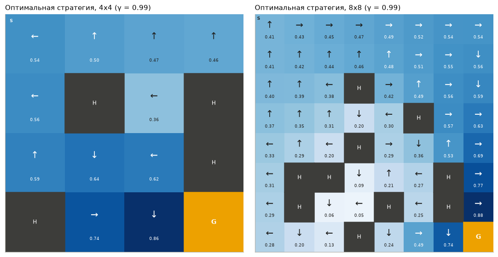

Слева 4×4, справа 8×8, γ = 0.99. Что видно:
* Ценности растут к цели (тёмные клетки внизу справа) и падают возле полыней.
* **Странные стрелки** — главное, что надо уметь объяснить. Из старта агент идёт **влево, в стену**. Назад не сносит, поэтому
  упираясь в стену, он либо стоит на месте, либо скользит вдоль стены вверх-вниз. В сторону полыньи его не унесёт никогда.
  Принцип везде один: повернуться так, чтобы полынья была «за спиной». Например, в клетке 4 (слева, второй ряд) стрелка ←:
  справа полынья 5, а вправо (назад) не сносит.
* На 8×8 то же самое: вдоль полыней агент ставит стрелки «от полыньи».

### График 2. Сходимость

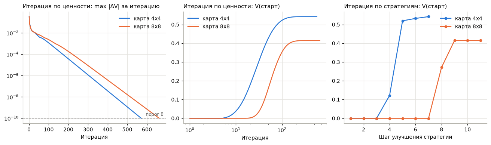

* **Слева** — насколько изменились ценности за итерацию итерации по ценности, шкала логарифмическая. **Прямая линия** вниз =
  геометрическое убывание: каждая итерация уменьшает изменение примерно в одно и то же число раз. Пунктир — порог θ = 10⁻¹⁰:
  где линия его пересекла, там и стоп (571 и 662 итерации).
* **В центре** — ценность старта по итерациям (ось x логарифмическая). Первые ~5 (4×4) и ~15 (8×8) итераций она ноль: ценность
  ещё не «дотекла» от цели до старта. Потом быстро растёт и выходит на плато 0.54 и 0.41.
* **Справа** — то же для итерации по стратегиям, по шагам улучшения. Первые шаги ноль (стратегия «везде влево» до цели не доходит),
  потом скачок почти до оптимума за 1–2 шага.

### График 3. Проверка в среде

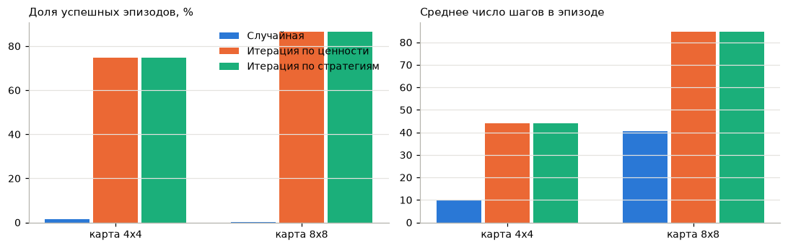

Столбики: случайная стратегия, итерация по ценности, итерация по стратегиям — для обеих карт.
* Слева доля успехов: случайная ≈ 0–2 %, оптимальные ≈ 75 % (4×4) и 86 % (8×8). Две оптимальные одинаковые — это одна стратегия.
* Справа среднее число шагов: оптимальная стратегия ходит долго (44 и 85 шагов), потому что осторожничает у стен.
  Случайная быстро проваливается (10 и 40 шагов).

### График 4. Влияние γ

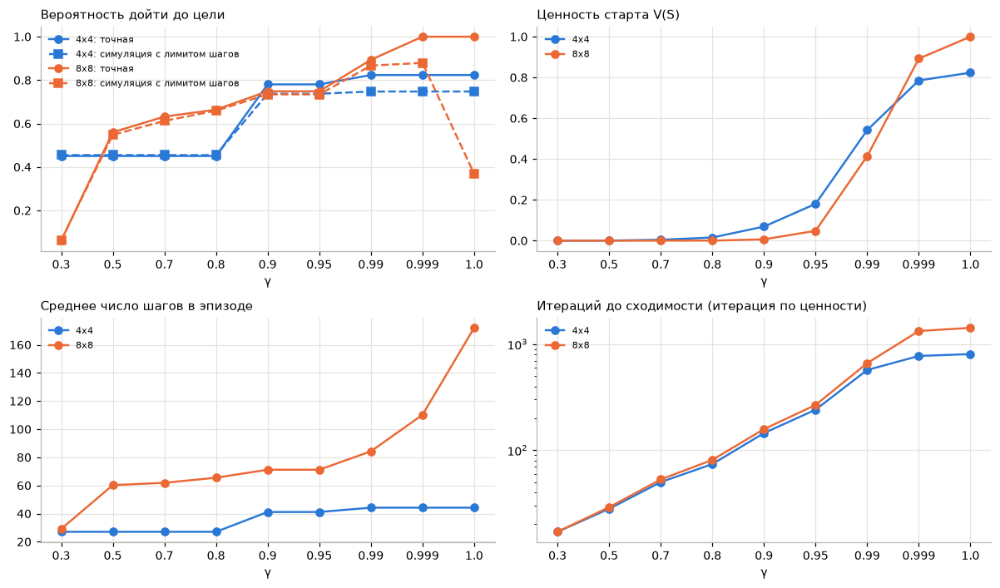

Ось x — значения γ, расставлены равномерно (иначе 0.99, 0.999 и 1 слиплись бы).
* **Вероятность дойти** (сплошные — точно, пунктир — в симуляции с лимитом). Растёт с γ ступеньками: стратегия меняется
  при определённых γ. Главное место — **8×8 при γ = 1**: точно 1.0, а в симуляции 0.37. Агент доходит всегда, но так медленно,
  что не укладывается в 200 шагов.
* **Ценность старта** растёт с γ: награда меньше дисконтируется. При γ = 1 совпадает с вероятностью дойти.
* **Число шагов** растёт с γ: дальновидный агент осторожнее и дольше идёт.
* **Итераций** (шкала логарифмическая) — растёт с γ: от 17 до 800–1400.

### График 5. Стратегии при разных γ (4×4)

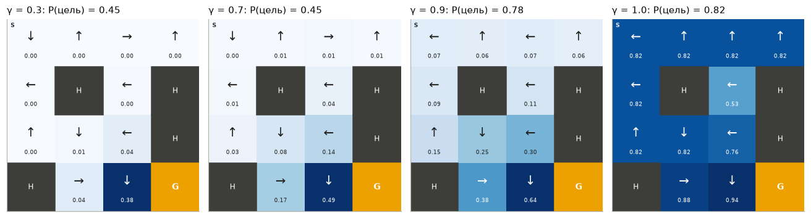

При γ = 0.3 почти все ценности ≈ 0 (белые клетки): цель слишком далеко, агенту почти всё равно. Стрелки другие, чем при γ = 1,
и успех 45 % против 82 %. При γ = 1 все клетки тёмные: при отсутствии дисконта ценность = вероятность дойти, а она высокая почти везде.

### График 6. Ловушка γ = 1

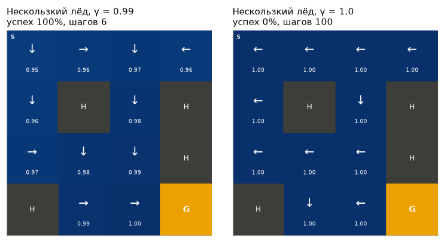

Нескользкий лёд. Слева γ = 0.99: стрелки ведут кратчайшим путём, 6 шагов, 100 % успеха. Справа γ = 1: все ценности 1.00,
стрелки почти везде ← — агент упирается в стену и стоит **вечно** (0 % успеха, эпизод обрывается на 100 шагах).
Почему: без дисконта «дойти за 6 шагов» и «дойти когда-нибудь» стоят одинаково (1.0), а «стоять на месте» тоже сохраняет ценность 1.
Все действия равны, жадная стратегия берёт первое — «влево».

### График 7. Порог θ

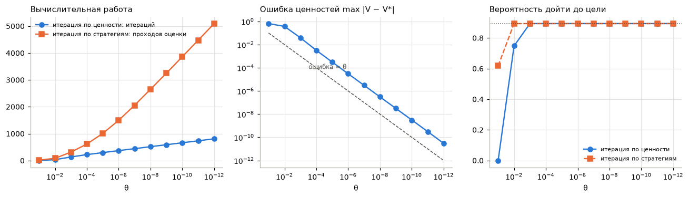

Ось x — θ от грубого (слева) к точному (справа).
* **Слева** — вычислительная работа: итерации по ценности растут ровно (линейно по числу знаков θ), проходы оценки у итерации
  по стратегиям — быстрее.
* **В центре** — ошибка ценностей против точного решения. Синяя линия параллельна пунктиру «ошибка = θ», но выше примерно в 30 раз:
  остановка по θ не гарантирует ошибку меньше θ.
* **Справа** — вероятность дойти полученной стратегии. Уже с θ = 10⁻³ стратегия оптимальна (пунктир сверху), хотя ценности ещё
  неточные. При θ = 0.1 у итерации по ценности стратегия бесполезная (0).

### График 8. Модифицированная итерация по стратегиям

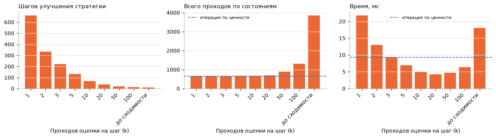

Ось x — сколько проходов оценки делать на каждом шаге (k).
* **Слева** — шагов улучшения: чем больше k, тем меньше (662 → 11).
* **В центре** — всего проходов: до k = 20 почти столько же, сколько у итерации по ценности (пунктир), дальше — резко больше.
* **Справа** — время: минимум при k = 10–20, быстрее и итерации по ценности, и классической итерации по стратегиям.

### График 9. Размер карты

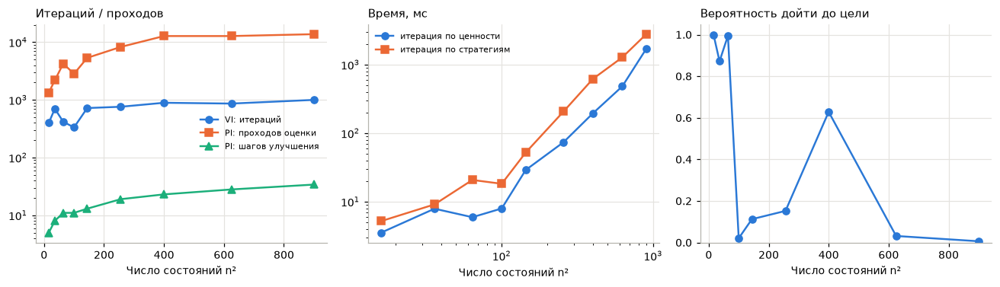

Случайные карты от 4×4 до 30×30.
* **Слева** — у итерации по ценности итераций почти одинаково при любом размере; у итерации по стратегиям растут и шаги улучшения,
  и проходы.
* **В центре** (обе оси логарифмические) — время растёт примерно как квадрат числа состояний; итерация по ценности всегда быстрее.
* **Справа** — вероятность дойти скачет от карты к карте: решает расположение полыней, а не размер.

### Графики 10 и 11. Скользкость

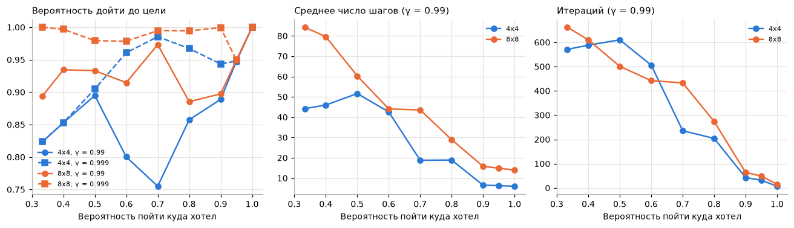

Ось x — вероятность пойти куда хотел (1/3 — стандарт, 1 — нескользкий лёд).
* **Слева** — вероятность дойти, сплошные линии для γ = 0.99, пунктир для γ = 0.999. При γ = 0.99 кривая скачет (не монотонная),
  при γ = 0.999 выше и ровнее. Объяснение: при γ = 0.99 агенту важна скорость, и с более надёжным ходом он выбирает быстрый
  рискованный путь.
* **В центре** — шагов: резко падает (44 → 6 и 84 → 14).
* **Справа** — итераций: тоже падает, в почти детерминированной среде всё сходится быстро.

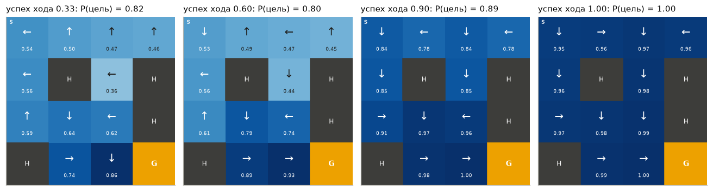

Стратегии на 4×4: при 1/3 — «влево, в стену», при 0.6 и выше из старта уже «вниз», а при 1.0 — прямой кратчайший путь.

### График 12. Плотность полыней

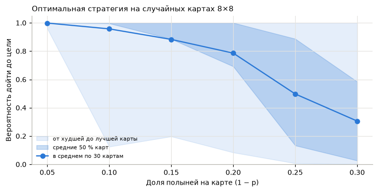

30 случайных карт 8×8 на каждую плотность. Линия — среднее; тёмная полоса — где половина карт; светлая — от худшей до лучшей.
Среднее падает (99.9 % → 31 %), но разброс огромный: при одной плотности есть карты и со 100 %, и почти с 0 %.

### График 13. Награды

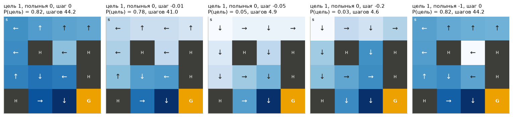

Пять вариантов наград (подписи: цель, полынья, шаг). Под подписью — вероятность дойти и шагов (на стандартной среде).
* Стандарт и «−1 за полынью» — одинаковые стратегии.
* −0.01 за шаг — чуть быстрее, чуть рискованнее.
* −0.05 и −0.2 за шаг — стрелки ведут **в полыньи**: агенту выгоднее быстро провалиться, чем долго идти и платить штраф. Успех 3–5 %.

<!-- pagebreak -->

## 7. Итоги в двух словах

* Оба алгоритма находят **одну и ту же** оптимальную стратегию. 4×4: 82 % дойти (точно), 75 % в симуляции; 8×8: 89 % и 86 %.
  Случайная: 1.6 % и 0.2 %.
* Итерация по ценности — сотни дешёвых итераций; итерация по стратегиям — 5–35 дорогих шагов. Здесь быстрее итерация по ценности,
  а ещё быстрее модифицированная итерация по стратегиям с k = 10–20.
* Оптимальная стратегия «прижимается к стенам», чтобы полынья была позади.
* γ: маленький — агент близорукий; большой — осторожный и медленный; γ = 1 — может вообще не идти к цели (ловушка равных ценностей).
* θ: стратегия становится оптимальной намного раньше, чем ценности становятся точными.
* Скользкость: меньше скользит → короче путь, быстрее сходимость; вероятность успеха немонотонна из-за обмена «скорость ↔ риск».
* Полыньи: больше → хуже, но решает расположение.
* Награды: большой штраф за шаг → агент прыгает в полынью.

<!-- pagebreak -->

## 8. Каверзные вопросы и ответы

**1. Что такое марковский процесс принятия решений?**
Задача из состояний, действий, вероятностей переходов и наград, где будущее зависит только от текущего состояния и действия,
а не от истории (марковское свойство). Цель — стратегия, максимизирующая ожидаемую дисконтированную сумму наград.

**2. Чем эта лаба отличается от бандитов?**
В бандитах одно состояние и неизвестная модель — учимся пробами. Здесь много состояний, действие влияет на следующее состояние,
и модель известна, поэтому стратегию можно вычислить без проб.

**3. Что такое уравнение Беллмана?**
Ценность состояния = награда за шаг + γ × ожидаемая ценность следующего состояния. Для оптимальной стратегии — с max по действиям.
Связывает ценность клетки с ценностями соседей, поэтому решается итерациями.

**4. Чем отличаются V(s) и Q(s, a)?**
V — ценность клетки при лучшем действии, Q — ценность конкретного действия в клетке. V(s) = max по a Q(s, a).
Стратегия — argmax по a Q(s, a).

**5. Как работает итерация по ценности и почему сходится?**
Многократно применяем уравнение оптимальности Беллмана ко всем клеткам. Оператор Беллмана — сжатие с коэффициентом γ: каждая итерация
уменьшает максимальную ошибку минимум в γ раз. Поэтому ошибка убывает геометрически (прямая на логарифмическом графике).

**6. Как работает итерация по стратегиям и почему она конечна?**
Чередуем оценку стратегии и жадное улучшение. По теореме об улучшении новая стратегия не хуже старой, а стратегий конечное число
(4^число клеток). Значит, через конечное число шагов стратегия перестанет меняться — это и есть оптимум.

**7. Какой алгоритм быстрее?**
Зависит от задачи. Итерация по стратегиям делает мало шагов, но каждый дорогой. У нас итерация по ценности быстрее: 5 мс против 7 мс на 4×4,
1.7 с против 2.8 с на 30×30. Быстрее всех модифицированная итерация по стратегиям с 10–20 проходами оценки.

**8. Почему оба алгоритма дали одну и ту же стратегию?**
Оптимальная функция ценности единственная (единственное решение уравнения оптимальности Беллмана), а оба алгоритма к ней сходятся.
Стратегии могут отличаться только в клетках, где несколько действий равноценны; у нас таких расхождений не было.

**9. Почему из старта агент идёт влево, в стену?**
Назад на скользком льду не сносит. Упираясь в стену, агент либо стоит, либо скользит вниз или вверх. Вправо, к полынье, его не унесёт.
Медленно, но безопасно. Так же в других клетках: полынья должна оказаться «за спиной».

**10. Почему ценность старта 0.54, а вероятность дойти 0.82?**
Ценность учитывает дисконт: подарок через ~44 шага стоит примерно 0.99⁴⁴ ≈ 0.64 от своей цены. 0.82 × «в среднем дисконт» ≈ 0.54.
При γ = 1 ценность старта в точности равна вероятности дойти.

**11. Почему симуляция дала 75 %, а точный расчёт 82 %?**
Лимит 100 шагов. Оптимальная стратегия медленная (в среднем 44 шага, но бывают и сотни), часть эпизодов обрывается до того, как агент
дошёл. Точный расчёт лимита не учитывает.

**12. Зачем нужен γ? Что будет при γ = 0 и γ = 1?**
γ задаёт, насколько ценно будущее, и гарантирует сходимость. γ = 0 — агент смотрит только на награду за один шаг: на озере это значит,
что важны только клетки рядом с целью, остальные получат ценность 0. γ = 1 — будущее не дешевеет: нет стимула торопиться,
сходимость не гарантируется теоремой о сжатии, и возможна ловушка равных ценностей (график 6).

**13. Объясните ловушку γ = 1 на нескользком льду.**
Все ценности равны 1: из любой клетки можно наверняка дойти. Значит, все действия, которые не ведут в полынью, равноценны, включая
«упереться в стену и стоять». Жадная стратегия выбирает первое из равных — «влево» — и агент стоит вечно. При γ < 1 короткий путь
ценнее длинного, и проблема исчезает.

**14. Почему при γ = 1 на 8×8 точная вероятность 1.0, а в симуляции 37 %?**
На этой карте можно дойти до цели наверняка, если не торопиться: обходить полыньи сколько угодно долго. При γ = 1 время ничего не стоит,
и агент выбирает самый надёжный, но очень долгий путь (в среднем больше 170 шагов). Лимит 200 шагов обрывает большую часть эпизодов.

**15. Как θ влияет на результат?**
Меньше θ — больше итераций (примерно +73 на каждый порядок) и точнее ценности. Но стратегия становится оптимальной гораздо раньше:
уже при θ = 10⁻³. Слишком большой θ (0.1) даёт плохую стратегию.

**16. Если изменение за итерацию меньше θ, то ошибка меньше θ?**
Нет. Теоретическая оценка: ошибка ≤ γθ / (1 − γ), при γ = 0.99 это до 99θ. У нас ошибка примерно в 30 раз больше θ.

**17. Что такое модифицированная итерация по стратегиям?**
Оцениваем стратегию не до сходимости, а k проходов, и сразу улучшаем. k = 1 — итерация по ценности, k = ∞ — классическая итерация
по стратегиям. Промежуточные k обычно быстрее обоих: незачем точно оценивать стратегию, которую всё равно сейчас поменяем.

**18. Почему при оценке стратегии начинаем с ценностей предыдущей?**
Новая стратегия обычно мало отличается от старой, и её ценности близки. Старт с них экономит проходы.
Результат от этого не меняется — оценка сходится к одному и тому же решению из любой начальной точки.

**19. Зачем в policy_iteration условие keep (менять действие только на строго лучшее)?**
Если два действия равноценны, без этого условия стратегия может бесконечно переключаться между ними, и алгоритм не остановится.

**20. Зачем округлять Q перед argmax?**
Из-за погрешности вычислений равные значения могут отличаться на 10⁻¹⁶, и argmax выберет случайное из них. После округления
равные считаются равными, выбор предсказуем, и итерации по ценности и по стратегиям дают одинаковые стрелки.

**21. Почему в T не попадают переходы, после которых эпизод кончается?**
После конца эпизода наград больше нет, значит, ценность «после» равна нулю. Убирая такие переходы из T, мы автоматически
получаем V = 0 для полыней и цели. Награда за попадание в цель при этом учтена в R.

**22. Как точно посчитать вероятность дойти до цели?**
Оценкой стратегии с γ = 1 и наградой 1 только за попадание в цель. Ценность старта тогда — ожидаемое число попаданий в цель,
а попасть можно максимум один раз, значит, это вероятность.

**23. Почему вероятность успеха не монотонно зависит от скользкости?**
Стратегия максимизирует дисконтированную награду, а не вероятность успеха. Когда ход становится надёжнее, быстрый путь мимо полыней
становится выгоднее медленного безопасного, и агент рискует. При γ = 0.999 скорость почти не ценится, и кривая выше и ровнее.
Плюс при 1/3 работает трюк со стеной, а при большой точности хода упор в стену почти всегда означает «стоять на месте».

**24. Почему при большом штрафе за шаг агент прыгает в полынью?**
Безопасный путь до цели длится ~44 шага, при штрафе 0.05 это −2.2, а цель даёт только +1. Провалиться сразу — это 0 и конец штрафов.
Для заданной награды это действительно оптимально. Мораль: награду надо проектировать аккуратно, алгоритм оптимизирует ровно её.

**25. Почему штраф −1 за полынью не изменил стратегию?**
Стратегия и так максимально избегала полыней. Штраф лишь уменьшил ценности клеток рядом с ними, но лучшие действия остались теми же.

**26. От чего зависит число итераций?**
Для итерации по ценности — в основном от γ и θ (худший случай log(1/θ) / log(1/γ)), почти не от размера карты.
Для итерации по стратегиям число шагов улучшения растёт с размером карты.

**27. Как время растёт с размером задачи?**
Один проход — умножение матрицы (S·A)×S на вектор, то есть ~S²·A операций. При 900 состояниях это 3.2 млн умножений на проход.
Реальные большие задачи так не решить — нужны методы без полной модели и с приближением функций.

**28. Можно ли применить эти алгоритмы, если env.P неизвестна?**
Нет, оба требуют полную модель переходов. Без модели используют обучение на опыте: Монте-Карло, TD, SARSA, Q-learning
(это следующие лабы).

**29. Почему разброс успеха между случайными картами такой большой?**
Решает расположение полыней. На скользком льду клетка с полыньями с двух сторон почти непроходима: куда ни иди, 1/3 шанс
провалиться. Если такая клетка на единственном пути — успех низкий даже при малом числе полыней.

**30. Почему случайная стратегия так плоха (1.6 %)?**
До цели 6 шагов, по пути полыньи, лёд скользит. Случайные стрелки почти всегда где-то ведут в полынью или в петлю.

**31. Что изменилось по сравнению с кодом методички (gym → gymnasium)?**
Та же среда, новая версия библиотеки. `reset()` возвращает (состояние, info), `step()` возвращает 5 значений:
`terminated` и `truncated` вместо одного `done`. Модель среды — та же `env.P`, нужен только `env.unwrapped.P`.

**32. Почему вы использовали numpy, а не torch?**
Здесь нет нейросетей и градиентов. Вся математика — умножение матриц на векторы, numpy для этого проще и быстрее.

<!-- pagebreak -->

## 9. Как всё запустить

```bash
source .venv/bin/activate                     # окружение (numpy, matplotlib, gymnasium, jupyter)
cd reinforcement-learning/02
jupyter notebook lab2_frozen_lake.ipynb       # открыть и выполнить все ячейки
```

Пересчитать без браузера:

```bash
jupyter nbconvert --to notebook --execute --inplace lab2_frozen_lake.ipynb
```

Если окружения нет: `python3 -m venv .venv && source .venv/bin/activate && pip install -r requirements.txt`.

Файлы:
* `lab2_frozen_lake.ipynb` — работа: код, графики, анализ;
* `Lab2_Leshkevich_09-535.pdf` — отчёт для сдачи;
* `guide.md` / `guide.pdf` — этот разбор;
* `figures/` — графики картинками.
